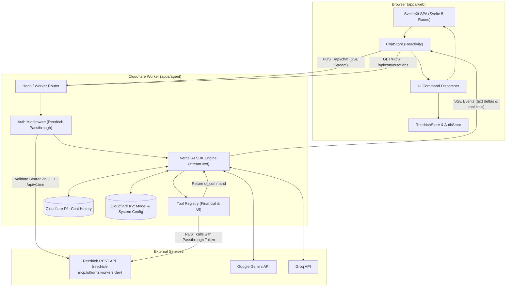
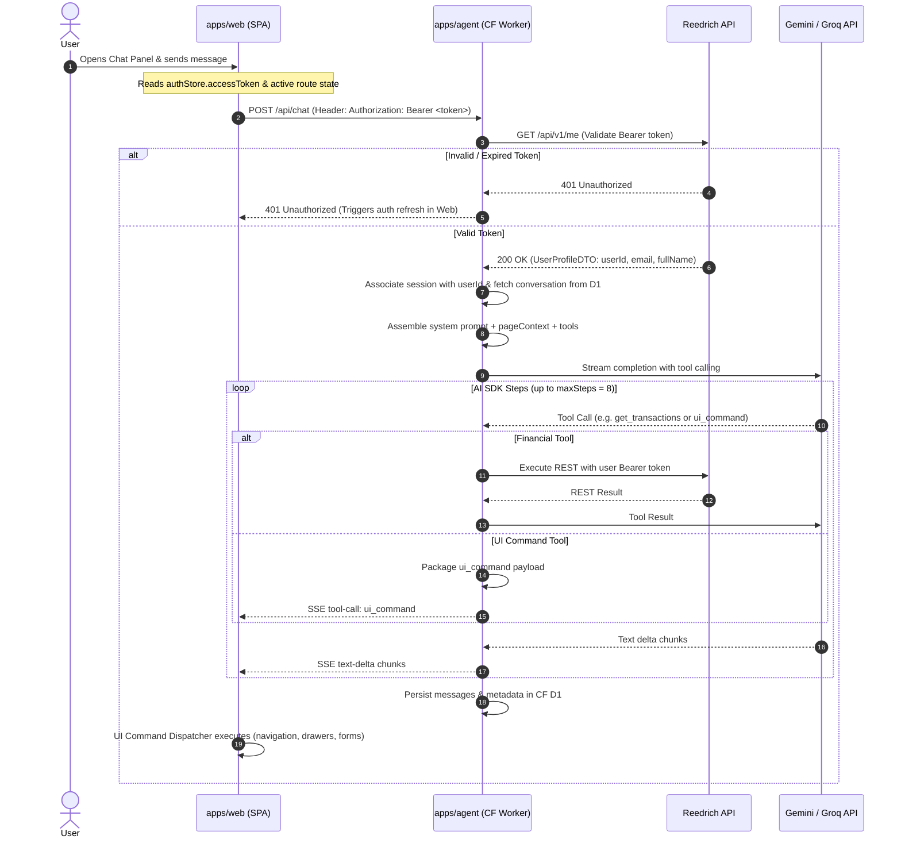
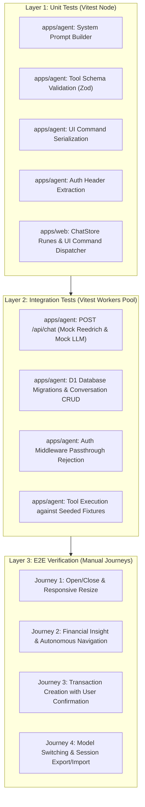

# Design: Embedded AI Agent Chat (`agent-chat`)

## Architecture

### System Overview

The `agent-chat` feature introduces an AI financial assistant directly integrated into Maniyy V2. The architecture spans a Bun monorepo composed of three packages:
- `apps/web`: SvelteKit SPA (adapter-static) with Svelte 5 runes, Tailwind v4, shadcn-svelte/bits-ui, phosphor-svelte.
- `apps/agent`: Cloudflare Worker hosting the AI agent backend powered by Vercel AI SDK (`streamText`), multi-step tool calls (`maxSteps: 8`), and Cloudflare D1/KV storage.
- `packages/shared`: Shared TypeScript types, data contracts, and validation schemas consumed by both workspaces.



### Monorepo Structure

```
lz-maniyy-v2/
├── package.json               # Bun workspaces root
├── bun.lockb                  # Single monorepo lockfile
├── apps/
│   ├── web/                   # SvelteKit SPA frontend
│   │   ├── package.json
│   │   ├── svelte.config.js
│   │   ├── vite.config.ts
│   │   └── src/
│   │       ├── lib/
│   │       │   ├── components/chat/   # Chat panel components
│   │       │   ├── stores/chat.svelte.ts # Svelte 5 Runes ChatStore
│   │       │   └── ...
│   │       └── routes/
│   └── agent/                 # Cloudflare Worker backend
│       ├── package.json
│       ├── wrangler.toml      # D1 & KV bindings, secrets
│       ├── src/
│       │   ├── index.ts       # Worker entry point & routing
│       │   ├── middleware/auth.ts # Reedrich token passthrough validator
│       │   ├── agent/         # AI SDK engine, system prompt, tools
│       │   ├── db/            # D1 queries & migrations
│       │   └── routes/        # /api/chat, /api/conversations, /api/models
│       └── vitest.config.ts
└── packages/
    └── shared/                # Shared types & schemas
        ├── package.json
        └── src/
            ├── index.ts
            ├── account-detail.ts
            ├── chat.ts
            ├── ui-commands.ts
            └── contracts.ts
```

### Authentication Flow (Zero Second Login)

Users authenticate via Google OAuth PKCE against Reedrich on `apps/web`, storing standard JWT credentials in `AuthStore` (`accessToken`, `refreshToken`, `expiresAt`).



### Data Flow for UI Commands

When the agent decides to modify the frontend interface (e.g., navigating to `/ledger`, applying an institution filter, opening the transaction drawer), it invokes a `ui_command` tool.
1. **Agent Execution**: The worker's tool returns `{ type: 'ui_command', command: string, payload: unknown, message: string }`.
2. **Streaming**: The tool call and result are sent over the SSE stream to `apps/web`.
3. **Dispatching**: The `ChatStore` receives the `ui_command`, displays an inline confirmation message in the chat timeline, and forwards the command to the `UICommandDispatcher`.
4. **Execution**: The dispatcher maps commands to SvelteKit `goto()`, `reedrichStore` methods (`setTab`, `filterByInstitution`, `openDrawer`), or `transactionFormStore.openCreate()`.

---

## Component Hierarchy

The chat interface is implemented within `apps/web/src/lib/components/chat/` using shadcn-svelte chat primitives, bits-ui, and Phosphor icons, fully adhering to the `minimalist-ui` design language (Warm Bone canvas `#F7F6F3`, 1px borders `#EAEAEA`, mono-spaced metadata).

```
+layout.svelte (App Shell)
├── Topbar.svelte
│   └── ChatToggleButton.svelte        <!-- Header trigger with unread badge & shortcut hint -->
├── <main> (Dynamic Width Container)
│   └── Page Content (Dashboard / Ledger / Wallets / Budgets)
├── ChatPanel.svelte                   <!-- Root chat panel container (Desktop side panel / Mobile overlay) -->
│   ├── ChatResizeHandle.svelte       <!-- Desktop-only draggable border handle -->
│   ├── ChatPanelHeader.svelte         <!-- Top bar: model picker, history drawer toggle, close -->
│   │   ├── ChatModelPicker.svelte     <!-- Dropdown for Gemini / Groq models -->
│   │   ├── Button (History toggle)   <!-- Slide-over drawer trigger -->
│   │   └── Button (Close panel)      <!-- Dismiss action -->
│   ├── ConversationList.svelte       <!-- Collapsible sidebar/overlay of conversation history -->
│   │   ├── Button (New Chat)
│   │   ├── ScrollArea
│   │   │   └── ConversationItem.svelte <!-- Conversation title, timestamp, delete button -->
│   │   └── ChatExportImport.svelte   <!-- Export/Import JSON dialog -->
│   ├── ChatMessages.svelte           <!-- Wraps shadcn MessageScroller -->
│   │   ├── MessageScroller (shadcn)
│   │   │   ├── ChatEmptyState.svelte  <!-- Suggested prompts & empty state guidance -->
│   │   │   └── {#each messages as message}
│   │   │       ├── ChatBubble.svelte <!-- Wraps shadcn Message + Bubble -->
│   │   │       │   ├── ChatAvatar.svelte
│   │   │       │   ├── MarkdownContent.svelte <!-- Editorial serif/sans text renderer -->
│   │   │       │   ├── ChatToolInvocation.svelte <!-- Collapsible tool run indicator -->
│   │   │       │   ├── ChatUICommandCard.svelte  <!-- Interactive badge showing UI action taken -->
│   │   │       │   └── ChatImageAttachment.svelte <!-- Image preview with fallback handling -->
│   │   │       └── {/each}
│   │   │   └── ChatStreamingIndicator.svelte <!-- Subtle bone-pulse typing dot -->
│   └── ChatInput.svelte              <!-- Multiline auto-resizing input box -->
│       ├── ImageAttachmentPreview.svelte <!-- Staged image thumbnail & remove button -->
│       ├── Textarea (Auto-resizing)  <!-- Enter to send, Shift+Enter newline -->
│       ├── Button (Attach Image)     <!-- Hidden file input trigger -->
│       └── Button (Send / Stop)      <!-- Dynamic send / abort button -->
└── TransactionFormDrawer.svelte       <!-- Can be activated programmatically by agent -->
```

### Component Specifications & Primitives

| Component | Primitives / Base | Responsibility |
|---|---|---|
| `ChatPanel.svelte` | `aside`, CSS Grid / Flex | Manages visibility, responsive transitions, desktop width binding (`ChatStore.panelWidth`), keyboard shortcuts (`Cmd+K`). |
| `ChatResizeHandle.svelte` | Custom pointer-capture bar | Handles horizontal mouse dragging, bounds panel width between 280px and 50vw, saves to `localStorage`. |
| `ChatPanelHeader.svelte` | `header`, shadcn `Button` | Displays active conversation title, controls for model switching, history, and panel dismissal. |
| `ChatModelPicker.svelte` | shadcn `Select`, `DropdownMenu` | Selects LLM provider (`gemini` vs `groq`) and specific model identifiers fetched from `/api/models`. |
| `ConversationList.svelte` | shadcn `ScrollArea`, `Button` | Lists historical sessions stored in D1, supports switching active chat and initiating new conversations. |
| `ChatMessages.svelte` | shadcn `MessageScroller` | Auto-scrolls on new deltas, preserves scroll position when inspecting past messages. |
| `ChatBubble.svelte` | shadcn `Message`, `Bubble` | Renders user and assistant bubbles, markdown styling, financial summary tables, and tool outputs. |
| `ChatUICommandCard.svelte` | shadcn `Badge`, Phosphor icons | Shows visual evidence of agent UI action (e.g. `Navigated to /ledger`, `Filter: BCA`). |
| `ChatImageAttachment.svelte` | `img` with onError fallback | Renders uploaded financial receipts/screenshots. Graceful fallback on missing/expired blobs. |
| `ChatInput.svelte` | `Textarea`, shadcn `Button` | Multi-line message input, image file drag-and-drop/upload, submit and stream cancellation. |
| `ChatExportImport.svelte` | shadcn `Dialog`, `Button` | Handles JSON export of current/all chats and JSON import validation. |

---

## State Architecture

### Frontend Store: `ChatStore` (Svelte 5 Runes)

Following the class-based runes store pattern established by `ReedrichStore` and `AuthStore`, `ChatStore` encapsulates all agent chat state, API streaming, and UI command dispatching.

```typescript
// apps/web/src/lib/stores/chat.svelte.ts
import { SvelteMap } from 'svelte/reactivity';
import { authStore } from './auth.svelte';
import { reedrichStore } from './reedrich.svelte';
import { transactionFormStore } from './transaction-form.svelte';
import { goto } from '$app/navigation';
import { page } from '$app/state';
import type {
  ChatMessage,
  ConversationMeta,
  ModelConfig,
  PageContext,
  UICommand
} from '@maniyy/shared';

export class ChatStore {
  // Reactive Runes State
  conversations = $state<ConversationMeta[]>([]);
  activeConversationId = $state<string | null>(null);
  messages = $state<ChatMessage[]>([]);
  isLoadingHistory = $state<boolean>(false);
  isStreaming = $state<boolean>(false);
  panelOpen = $state<boolean>(false);
  panelWidth = $state<number>(360); // Default pixels (~20% on 1920)
  availableModels = $state<ModelConfig[]>([]);
  selectedModel = $state<ModelConfig>({
    provider: 'gemini',
    model: 'gemini-1.5-flash',
    displayName: 'Gemini 1.5 Flash'
  });

  private abortController: AbortController | null = null;
  private readonly STORAGE_WIDTH_KEY = 'maniyy_chat_panel_width';

  constructor() {
    if (typeof window !== 'undefined') {
      const savedWidth = localStorage.getItem(this.STORAGE_WIDTH_KEY);
      if (savedWidth) this.panelWidth = Math.max(280, Math.min(window.innerWidth * 0.5, Number(savedWidth)));
    }
  }

  // Derived Properties
  activeConversation = $derived(
    this.conversations.find((c) => c.id === this.activeConversationId) ?? null
  );

  hasMessages = $derived(this.messages.length > 0);

  // Actions
  togglePanel = (force?: boolean) => {
    this.panelOpen = force !== undefined ? force : !this.panelOpen;
  };

  setPanelWidth = (widthPx: number) => {
    const clamped = Math.max(280, Math.min(window.innerWidth * 0.5, widthPx));
    this.panelWidth = clamped;
    if (typeof window !== 'undefined') {
      localStorage.setItem(this.STORAGE_WIDTH_KEY, clamped.toString());
    }
  };

  setModel = (model: ModelConfig) => {
    this.selectedModel = model;
  };

  // Assembles Level 2 UI Context from active SvelteKit route & stores
  buildPageContext = (): PageContext => {
    return {
      currentRoute: page.url.pathname,
      activeTab: reedrichStore.activeTab,
      selectedInstitution: reedrichStore.selectedInstitution,
      drawerOpen: reedrichStore.activeDrawer !== null,
      drawerType: reedrichStore.activeDrawer?.type,
      summary: {
        totalNetWorth: reedrichStore.snapshot?.netWorth.consolidated.total,
        totalSpendable: reedrichStore.snapshot?.wallets.spendable.total,
        totalLocked: reedrichStore.snapshot?.wallets.locked.total,
        walletCount: reedrichStore.allWallets.length,
        hasCashFlow: Boolean(reedrichStore.snapshot?.monthlyCashFlow)
      }
    };
  };

  // Message Sending & SSE Streaming
  sendMessage = async (text: string, image?: { data: string; mimeType: string }) => {
    if (!text.trim() && !image) return;
    if (!authStore.accessToken) throw new Error('Unauthenticated');

    const userMessage: ChatMessage = {
      id: crypto.randomUUID(),
      role: 'user',
      content: text,
      timestamp: new Date().toISOString(),
      image: image ? { mimeType: image.mimeType } : undefined
    };

    this.messages = [...this.messages, userMessage];
    this.isStreaming = true;

    const assistantMessageId = crypto.randomUUID();
    const assistantMessage: ChatMessage = {
      id: assistantMessageId,
      role: 'assistant',
      content: '',
      timestamp: new Date().toISOString(),
      toolInvocations: []
    };
    this.messages = [...this.messages, assistantMessage];

    this.abortController = new AbortController();

    try {
      const response = await fetch('/api/chat', {
        method: 'POST',
        headers: {
          'Content-Type': 'application/json',
          Authorization: `Bearer ${authStore.accessToken}`
        },
        body: JSON.stringify({
          message: text,
          conversationId: this.activeConversationId ?? undefined,
          pageContext: this.buildPageContext(),
          model: {
            provider: this.selectedModel.provider,
            model: this.selectedModel.model
          },
          image
        }),
        signal: this.abortController.signal
      });

      if (!response.ok) {
        throw new Error(`Chat API error: ${response.status} ${response.statusText}`);
      }

      await this.handleSSEStream(response.body!, assistantMessageId);
    } catch (err: any) {
      if (err.name === 'AbortError') {
        // Graceful stream abort
      } else {
        this.appendAssistantError(assistantMessageId, err.message || 'Gagal menghubungi asisten.');
      }
    } finally {
      this.isStreaming = false;
      this.abortController = null;
    }
  };

  stopStreaming = () => {
    if (this.abortController) {
      this.abortController.abort();
      this.isStreaming = false;
    }
  };

  // SSE Stream parsing protocol
  private handleSSEStream = async (stream: ReadableStream<Uint8Array>, targetMessageId: string) => {
    const reader = stream.getReader();
    const decoder = new TextDecoder();
    let buffer = '';

    while (true) {
      const { done, value } = await reader.read();
      if (done) break;

      buffer += decoder.decode(value, { stream: true });
      const lines = buffer.split('\n');
      buffer = lines.pop() ?? '';

      for (const line of lines) {
        if (!line.startsWith('data: ')) continue;
        const data = line.slice(6).trim();
        if (data === '[DONE]') return;

        try {
          const event = JSON.parse(data);
          this.processStreamEvent(event, targetMessageId);
        } catch {
          // Ignore partial or non-json chunk
        }
      }
    }
  };

  private processStreamEvent = (event: any, targetMessageId: string) => {
    const msgIndex = this.messages.findIndex((m) => m.id === targetMessageId);
    if (msgIndex === -1) return;

    if (event.type === 'text-delta') {
      this.messages[msgIndex].content += event.textDelta;
    } else if (event.type === 'tool-call') {
      this.messages[msgIndex].toolInvocations = [
        ...(this.messages[msgIndex].toolInvocations ?? []),
        {
          toolCallId: event.toolCallId,
          toolName: event.toolName,
          args: event.args,
          state: 'call'
        }
      ];
      if (event.toolName === 'ui_command') {
        this.executeUICommand(event.args as UICommand);
      }
    } else if (event.type === 'tool-result') {
      const invocations = this.messages[msgIndex].toolInvocations ?? [];
      const inv = invocations.find((i) => i.toolCallId === event.toolCallId);
      if (inv) {
        inv.state = 'result';
        inv.result = event.result;
      }
    }
  };

  // UI Command Execution Engine
  executeUICommand = (cmd: UICommand) => {
    switch (cmd.action) {
      case 'navigate':
        goto(cmd.payload.path);
        break;
      case 'set_tab':
        reedrichStore.activeTab = cmd.payload.tab;
        break;
      case 'filter_institution':
        reedrichStore.selectedInstitution = cmd.payload.institution;
        break;
      case 'open_drawer':
        reedrichStore.openDrawer(cmd.payload.type, cmd.payload.title, cmd.payload.data);
        break;
      case 'open_transaction_form':
        transactionFormStore.openCreate(cmd.payload?.initialData);
        break;
      case 'focus_element':
        const el = document.querySelector(cmd.payload.selector) as HTMLElement | null;
        el?.focus();
        el?.scrollIntoView({ behavior: 'smooth', block: 'center' });
        break;
    }
  };

  // History CRUD
  loadConversations = async () => { /* Fetch /api/conversations */ };
  loadConversation = async (id: string) => { /* Fetch /api/conversations/:id */ };
  deleteConversation = async (id: string) => { /* DELETE /api/conversations/:id */ };
  exportConversations = async (ids?: string[]) => { /* POST /api/conversations/export */ };
  importConversations = async (data: any) => { /* POST /api/conversations/import */ };

  private appendAssistantError = (id: string, message: string) => {
    const idx = this.messages.findIndex((m) => m.id === id);
    if (idx !== -1) {
      this.messages[idx].content += `\n\n*(Terjadi kesalahan: ${message})*`;
    }
  };
}

export const chatStore = new ChatStore();
```

### Backend Architecture: `apps/agent`

The Cloudflare Worker does not maintain UI stores. It is constructed with pure functional HTTP request handlers and middleware:

1. **Routing (`src/index.ts`)**: Fast, lightweight route dispatching (`/api/chat`, `/api/conversations`, `/api/models`).
2. **Auth Middleware (`src/middleware/auth.ts`)**:
   - Extracts `Bearer <token>` from incoming `Authorization` headers.
   - Validates the token by making an upstream HTTP request to Reedrich's `GET /api/v1/me`.
   - Caches verification results for 60 seconds in Worker memory/KV to avoid latency on consecutive streaming queries.
   - Attaches `user: UserProfileDTO` and `token: string` to context.
3. **Chat Route (`src/routes/chat.ts`)**:
   - Initializes Vercel AI SDK `streamText` using selected provider (`@ai-sdk/google` or `@ai-sdk/groq`).
   - Injects system prompt with dynamic `pageContext`.
   - Mounts financial and UI tools with `passthroughToken`.
   - Sets `maxSteps: 8` for multi-step reasoning.
   - Converts stream output to standard SSE response and saves completion to D1 asynchronously via `ctx.waitUntil()`.

---

## Data Contracts

### 1. `POST /api/chat`

#### Request Payload
```typescript
export interface ChatRequestDTO {
  message: string;
  conversationId?: string;
  pageContext: PageContext;
  model?: {
    provider: 'gemini' | 'groq';
    model: string;
  };
  image?: {
    data: string; // Base64 encoded image string (ephemeral, not stored in D1)
    mimeType: string; // e.g. 'image/png', 'image/jpeg', 'image/webp'
  };
}

export interface PageContext {
  currentRoute: string; // e.g. '/', '/ledger', '/wallets'
  activeTab?: 'all' | 'spendable' | 'locked';
  selectedInstitution?: string | null;
  drawerOpen: boolean;
  drawerType?: 'wallet' | 'category' | 'budget' | 'goal' | 'obligation' | 'networth';
  summary?: {
    totalNetWorth?: number;
    totalSpendable?: number;
    totalLocked?: number;
    walletCount?: number;
    hasCashFlow?: boolean;
  };
}
```

#### Response Stream (SSE - Server-Sent Events)
Content-Type: `text/event-stream; charset=utf-8`

Stream chunks follow the AI SDK Data Stream Protocol:
- `data: {"type":"text-delta","textDelta":"Halo! "}\n\n`
- `data: {"type":"tool-call","toolCallId":"call_123","toolName":"get_account_detail","args":{}}\n\n`
- `data: {"type":"tool-result","toolCallId":"call_123","result":{"netWorth":{...}}}\n\n`
- `data: {"type":"tool-call","toolCallId":"call_456","toolName":"ui_command","args":{"action":"navigate","payload":{"path":"/ledger"}}}\n\n`
- `data: {"type":"finish","finishReason":"stop"}\n\n`
- `data: [DONE]\n\n`

### 2. `GET /api/conversations`
- **Response**: `ConversationMeta[]`
```typescript
export interface ConversationMeta {
  id: string;
  userId: string;
  title: string;
  createdAt: string;
  updatedAt: string;
  messageCount: number;
  lastMessageSnippet: string;
}
```

### 3. `GET /api/conversations/:id`
- **Response**: `ConversationDetailDTO`
```typescript
export interface ConversationDetailDTO extends ConversationMeta {
  messages: ChatMessage[];
}

export interface ChatMessage {
  id: string;
  role: 'user' | 'assistant' | 'system';
  content: string;
  timestamp: string;
  image?: {
    mimeType: string;
  };
  toolInvocations?: Array<{
    toolCallId: string;
    toolName: string;
    args: Record<string, unknown>;
    state: 'call' | 'result';
    result?: Record<string, unknown>;
  }>;
}
```

### 4. `POST /api/conversations/export`
- **Request**: `{ conversationIds?: string[] }` (omitted array exports all conversations for user)
- **Response**:
```typescript
export interface ExportPayload {
  version: 1;
  exportedAt: string;
  conversations: ConversationDetailDTO[];
}
```

### 5. `POST /api/conversations/import`
- **Request**: `{ conversations: ConversationDetailDTO[] }`
- **Response**: `{ imported: number; updated: number }`

### 6. `GET /api/models`
- **Response**: `ModelConfig[]`
```typescript
export interface ModelConfig {
  provider: 'gemini' | 'groq';
  model: string;
  displayName: string;
  contextWindow?: number;
  isDefault?: boolean;
}
```

### 7. UI Command Schema (`UICommand`)
```typescript
export type UICommand =
  | { action: 'navigate'; payload: { path: string } }
  | { action: 'set_tab'; payload: { tab: 'all' | 'spendable' | 'locked' } }
  | { action: 'filter_institution'; payload: { institution: string | null } }
  | { action: 'open_drawer'; payload: { type: DrawerType; title: string; data?: any } }
  | { action: 'open_transaction_form'; payload?: { initialData?: Partial<CreateTransactionPayload> } }
  | { action: 'focus_element'; payload: { selector: string } };
```

---

## Agent System

### Persona and System Prompt

The system prompt configures the agent as **Eve Finn**, an intelligent Indonesian-speaking personal financial architect embedded into Maniyy V2.

```markdown
Anda adalah Eve Finn, asisten finansial pribadi cerdas yang terintegrasi di Maniyy V2.
Bahasa utama: Bahasa Indonesia yang profesional, ramah, ringkas, dan analitis.

Pedoman Perilaku:
1. Konfirmasi Mutasi: Anda TIDAK BOLEH melakukan mutasi permanen (POST, PATCH, DELETE transaksi atau transfer) tanpa persetujuan eksplisit dari pengguna. Tampilkan rincian (nominal, dompet, kategori) sebelum mengeksekusi tool mutasi.
2. Penjelasan Logika: Jelaskan dasar perhitungan Anda (misal: "Saldo aman dihitung dari kas lancar dikurangi kewajiban tempo terdekat").
3. Integrasi UI: Manfaatkan tool `ui_command` untuk membantu pengguna. Jika pengguna bertanya tentang transaksi buku besar, navigasikan mereka ke `/ledger` atau buka drawer terkait.
4. Kesadaran Konteks UI: Anda mengetahui halaman yang sedang dibuka pengguna dan ringkasan data yang terlihat melalui objek PageContext berikut:
   - Route saat ini: {{currentRoute}}
   - Tab aktif: {{activeTab}}
   - Ringkasan Net Worth: {{summary.totalNetWorth}}
   - Total Spendable: {{summary.totalSpendable}}
5. Efisiensi Tool: Gunakan query spesifik saat mengambil transaksi. Jangan menarik semua transaksi jika filter wallet/kategori sudah diketahui.
```

### Tool Definitions & Zod Schemas

Tools are categorized into **Financial Data Tools** (wrapping Reedrich REST API) and **UI Interaction Tools** (interpreted by the frontend).

```typescript
import { z } from 'zod';
import { tool } from 'ai';

export const createAgentTools = (token: string, reedrichApiUrl: string) => ({
  // 1. Get Overall Financial Snapshot
  get_account_detail: tool({
    description: 'Mengambil ringkasan detail akun pengguna: net worth, daftar dompet (spendable & locked), arus kas, anggaran, tujuan, dan kewajiban.',
    parameters: z.object({}),
    execute: async () => {
      const res = await fetch(`${reedrichApiUrl}/api/v1/account-detail`, {
        headers: { Authorization: `Bearer ${token}` }
      });
      if (!res.ok) throw new Error(`Reedrich API error: ${res.statusText}`);
      return await res.json();
    }
  }),

  // 2. Query Transactions
  get_transactions: tool({
    description: 'Mencari transaksi berdasarkan filter dompet, kategori, anggaran, limit, dan offset.',
    parameters: z.object({
      walletId: z.string().optional().describe('ID dompet spesifik'),
      categoryId: z.string().optional().describe('ID kategori'),
      budgetId: z.string().optional().describe('ID anggaran'),
      limit: z.number().default(20).describe('Batas jumlah data'),
      offset: z.number().default(0).describe('Offset pagination')
    }),
    execute: async (params) => {
      const q = new URLSearchParams();
      if (params.walletId) q.set('walletId', params.walletId);
      if (params.categoryId) q.set('categoryId', params.categoryId);
      if (params.budgetId) q.set('budgetId', params.budgetId);
      q.set('limit', params.limit.toString());
      q.set('offset', params.offset.toString());

      const res = await fetch(`${reedrichApiUrl}/api/v1/transactions?${q}`, {
        headers: { Authorization: `Bearer ${token}` }
      });
      return await res.json();
    }
  }),

  // 3. Create Transaction
  create_transaction: tool({
    description: 'Mencatat transaksi baru (pemasukan atau pengeluaran). WAJIB konfirmasi pengguna sebelum panggil.',
    parameters: z.object({
      walletId: z.string().describe('ID dompet'),
      categoryId: z.string().describe('ID kategori'),
      budgetId: z.string().optional().describe('ID anggaran terkait jika ada'),
      amount: z.number().positive().describe('Nominal transaksi dalam mata uang lokal'),
      adminFee: z.number().default(0).describe('Biaya admin jika ada'),
      transactionType: z.enum(['expense', 'income']).describe('Tipe transaksi'),
      transactionDescription: z.string().optional().describe('Keterangan transaksi'),
      transactionDate: z.string().describe('Tanggal transaksi format YYYY-MM-DD')
    }),
    execute: async (payload) => {
      const res = await fetch(`${reedrichApiUrl}/api/v1/transactions`, {
        method: 'POST',
        headers: {
          'Content-Type': 'application/json',
          Authorization: `Bearer ${token}`
        },
        body: JSON.stringify(payload)
      });
      return await res.json();
    }
  }),

  // 4. Create Transfer
  create_transfer: tool({
    description: 'Memindahkan saldo antar dompet. WAJIB konfirmasi pengguna sebelum panggil.',
    parameters: z.object({
      sourceWalletId: z.string().describe('ID dompet asal'),
      targetWalletId: z.string().describe('ID dompet tujuan'),
      amount: z.number().positive().describe('Nominal transfer'),
      adminFee: z.number().default(0).describe('Biaya admin transfer jika ada'),
      transferDescription: z.string().optional().describe('Catatan transfer'),
      transferDate: z.string().describe('Tanggal transfer YYYY-MM-DD')
    }),
    execute: async (payload) => {
      const res = await fetch(`${reedrichApiUrl}/api/v1/transfers`, {
        method: 'POST',
        headers: {
          'Content-Type': 'application/json',
          Authorization: `Bearer ${token}`
        },
        body: JSON.stringify(payload)
      });
      return await res.json();
    }
  }),

  // 5. Update Transaction
  update_transaction: tool({
    description: 'Memperbarui data transaksi yang sudah tercatat. WAJIB konfirmasi pengguna.',
    parameters: z.object({
      id: z.string().describe('ID transaksi yang akan diubah'),
      amount: z.number().positive().optional(),
      categoryId: z.string().optional(),
      transactionDescription: z.string().optional()
    }),
    execute: async ({ id, ...body }) => {
      const res = await fetch(`${reedrichApiUrl}/api/v1/transactions/${id}`, {
        method: 'PATCH',
        headers: {
          'Content-Type': 'application/json',
          Authorization: `Bearer ${token}`
        },
        body: JSON.stringify(body)
      });
      return await res.json();
    }
  }),

  // 6. Delete Transaction
  delete_transaction: tool({
    description: 'Menghapus transaksi berdasarkan ID. WAJIB konfirmasi pengguna.',
    parameters: z.object({
      id: z.string().describe('ID transaksi yang akan dihapus')
    }),
    execute: async ({ id }) => {
      const res = await fetch(`${reedrichApiUrl}/api/v1/transactions/${id}`, {
        method: 'DELETE',
        headers: { Authorization: `Bearer ${token}` }
      });
      return { success: res.ok };
    }
  }),

  // 7. Get Categories
  get_categories: tool({
    description: 'Mengambil daftar seluruh kategori transaksi yang tersedia.',
    parameters: z.object({}),
    execute: async () => {
      const res = await fetch(`${reedrichApiUrl}/api/v1/categories`, {
        headers: { Authorization: `Bearer ${token}` }
      });
      return await res.json();
    }
  }),

  // 8. UI Command Tool (Dispatched to Browser)
  ui_command: tool({
    description: 'Mengendalikan antarmuka browser: navigasi halaman, buka drawer, filter institusi/tab, atau buka form transaksi.',
    parameters: z.object({
      action: z.enum([
        'navigate',
        'set_tab',
        'filter_institution',
        'open_drawer',
        'open_transaction_form',
        'focus_element'
      ]),
      payload: z.record(z.any()).describe('Parameter aksi spesifik sesuai action'),
      message: z.string().describe('Pesan singkat ke pengguna mengenai aksi yang dilakukan')
    }),
    execute: async (args) => {
      // Returned to AI SDK as tool-result and streamed to client for immediate execution
      return { status: 'command_dispatched', ...args };
    }
  })
});
```

### Reasoning and Execution Parameters

- **`maxSteps: 8`**: Enables multi-hop autonomous problem solving (e.g. step 1: fetch categories, step 2: fetch wallets, step 3: calculate monthly burn, step 4: formulate financial recommendation, step 5: trigger UI filter).
- **Graceful Error Recovery**: If a tool call to Reedrich returns `404` or `400`, the tool result returns the JSON error payload to the model; the model uses subsequent steps to inspect available IDs and explain the corrective action to the user.

---

## Responsive Layout

The chat interface is fully responsive across all device sizes, strictly adhering to the `minimalist-ui` guidelines.

```
Desktop (>= 1024px) Layout:
+-------------------------------------------------------------+
| Topbar (Brand, Navigation, User, [Agent Toggle (Cmd+K)])     |
+-------------------------------------------------------------+
| [Main App Container (Auto Flex)]   | | [Chat Panel (20%-50%)]|
|                                    |D| - Header (Model pick)|
| - Dashboard / Ledger / Budgets     |R| - Messages (Scroll)  |
| - Tables, Cards, Metric tiles      |A| - Tool & UI cards    |
| - Preserves width & alignment      |G| - Input & Attach     |
+-------------------------------------------------------------+

Mobile (< 1024px) Layout:
+-------------------------------------------------------------+
| Topbar ([Maniyy], [Agent Chat Icon])                         |
+-------------------------------------------------------------+
| Main App Page Content                                       |
|                                                             |
+-------------------------------------------------------------+
| Bottom Navigation Bar (Hidden when chat overlay active)     |
+-------------------------------------------------------------+
| [FULLSCREEN CHAT OVERLAY (z-50)]                            |
| - Header: [< Back to App] [Model Picker] [Options]         |
| - Messages List (Safe area padded)                          |
| - Input (Touch-friendly 44px tap targets, keyboard aware)   |
+-------------------------------------------------------------+
```

### Behavior Breakdown

| Property | Desktop (`>= 1024px`) | Mobile (`< 1024px`) |
|---|---|---|
| **Mounting** | Side-by-side flex sibling within the main viewport container. | Fullscreen overlay (`fixed inset-0 z-50`). |
| **Default Width** | `20vw` (stored in `localStorage`), constrained: `280px <= width <= 50vw`. | `100vw`, `100dvh` (respects mobile dynamic viewport). |
| **Resizing** | Vertical drag handle on left border (`ChatResizeHandle.svelte`). | None (fixed fullscreen). |
| **Background** | `var(--color-surface)` (`#FFFFFF`) with 1px border `var(--color-border)` (`#EAEAEA`). | `var(--color-canvas)` (`#F7F6F3`). |
| **App Shell Impact** | Main content flexes smoothly with 200ms ease transition. No layout shift. | App shell is obscured underneath. Bottom navigation bar is hidden (`display: none`). |
| **Keyboard Shortcut** | `Cmd+K` (macOS) / `Ctrl+K` (Windows/Linux) toggles panel open/close. | N/A (Tap header button or back icon). |
| **Dismissal** | Click close button (`X`) or press `Escape` when focused. | Tap header back button `<-` or swipe right from edge. |

---

## Test Strategy

The testing architecture spans pure unit logic, Cloudflare Workers runtime integration, and manual end-to-end journey verifications.



### Layer 1: Unit Tests (`apps/agent` & `apps/web` - Vitest Node)

1. **`apps/agent/test/unit/prompt.test.ts`**:
   - `buildSystemPrompt()` properly formats Indonesian instructions.
   - Context injection embeds `currentRoute`, `activeTab`, and `summary` numbers correctly.
   - Handles empty/undefined `pageContext` gracefully without throwing.
2. **`apps/agent/test/unit/tools.test.ts`**:
   - Validates Zod schema parsing for all 8 tools (`create_transaction`, `create_transfer`, `ui_command`, etc.).
   - Asserts non-negative numbers for transaction amounts.
   - Rejects missing required parameters (`walletId`, `transactionDate`).
3. **`apps/agent/test/unit/auth-utils.test.ts`**:
   - Extracts Bearer token from well-formed headers.
   - Returns null/errors on missing or malformed `Authorization` headers (`Basic`, empty string).
4. **`apps/web/test/unit/chat-store.test.ts`**:
   - `ChatStore.togglePanel()` updates runes state and triggers persistence.
   - `ChatStore.setPanelWidth()` clamps widths between `280px` and `50vw`.
   - `ChatStore.executeUICommand()` dispatches correct store mutations and navigation calls.

### Layer 2: Integration Tests (`apps/agent` - Vitest Cloudflare Workers Pool)

Executes with `@cloudflare/vitest-pool-workers`, utilizing real in-memory SQLite D1 and Miniflare KV bindings.

1. **`apps/agent/test/integration/auth-middleware.test.ts`**:
   - Validates rejection (`401 Unauthorized`) when upstream `GET /api/v1/me` returns 401.
   - Validates context propagation when Reedrich returns valid `UserProfileDTO`.
2. **`apps/agent/test/integration/conversations-d1.test.ts`**:
   - Applies SQLite migrations for conversations and messages schema.
   - Performs CRUD operations: creates session, appends messages, lists user conversations, and deletes session.
   - Verifies user isolation (user A cannot read or delete user B's conversations).
3. **`apps/agent/test/integration/chat-stream.test.ts`**:
   - Tests `POST /api/chat` end-to-end with mocked LLM stream deltas and mocked Reedrich REST responses.
   - Verifies SSE headers: `Content-Type: text/event-stream`.
   - Asserts tool call serialization for `ui_command` and financial tools.
   - Verifies D1 persistence after stream completion.
   - Uses test Reedrich credentials for seeded fixture tests:
     - `apiKey`: `rd_live_6133a5ec3ca3c2fc1d224f677cc31c13`
     - `userId`: `usr_muhwbsfe_722e117da986448e`

### Layer 3: Manual E2E Acceptance Journeys

Executed by manual tester or developer via `pnpm run dev` across desktop and mobile viewports:

| Journey ID | Title | Steps | Expected Outcome |
|---|---|---|---|
| **E2E-01** | Panel Navigation & Toggle | 1. Press `Cmd+K` on dashboard.<br>2. Drag resize handle to 35vw.<br>3. Refresh page.<br>4. Switch to mobile view (390px). | 1. Panel slides in smoothly (200ms).<br>2. Width adjusts without layout jank.<br>3. Width retained from `localStorage`.<br>4. Becomes full-screen overlay; bottom nav hidden. |
| **E2E-02** | Read-Only Financial Query & UI Action | 1. Ask: "Berapa total saldo kas saya dan tolong buka buku besarnya?" | 1. Agent calls `get_account_detail`.<br>2. Answers with spendable total.<br>3. Agent calls `ui_command(action: 'navigate', path: '/ledger')`.<br>4. Browser navigates to `/ledger`. |
| **E2E-03** | Mutation Confirmation Guard | 1. Ask: "Catat pengeluaran makan siang 45000 di BCA." | 1. Agent asks for user confirmation first with details.<br>2. User replies: "Ya, lanjutkan."<br>3. Agent calls `create_transaction`.<br>4. Success badge rendered in chat. |
| **E2E-04** | Model Switching & Session Portability | 1. Switch model from Gemini to Groq.<br>2. Send message.<br>3. Export chat to JSON.<br>4. Delete chat.<br>5. Import JSON back. | 1. Request routes to Groq API.<br>2. JSON file downloads with valid schema.<br>3. Conversation restored in history sidebar. |
