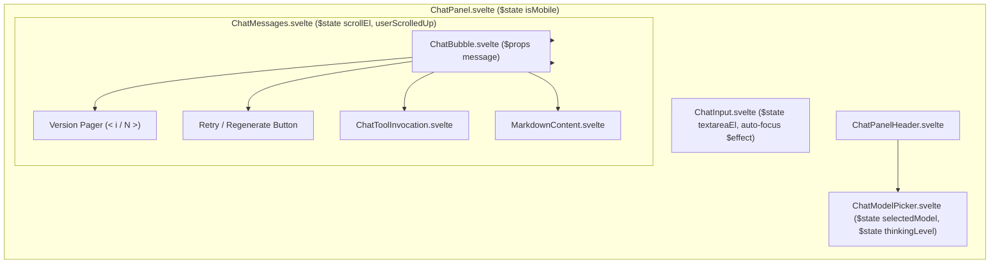

# Design

## Context

Lihat `proposal.md` untuk motivasi dan latar belakang kebutuhan. Saat ini, sistem chat agen terbagi menjadi frontend Svelte 5 (`apps/web`), shared types (`packages/shared`), dan Cloudflare Worker backend (`apps/agent`). Implementasi backend saat ini memiliki keterbatasan pada eksekusi generator streaming ketika model memanggil tool dalam beberapa langkah bertahap, serta belum mengintegrasikan model OpenCode Zen dan kontrol thinking level. Di frontend, bubble pesan asisten bersifat linear tanpa opsi mengulang atau memilih versi jawaban sebelumnya, dan input chat belum fokus otomatis saat panel dibuka.

## Goals / Non-Goals

**Goals:**
- Menjamin kelancaran streaming multi-step tool execution tanpa terminasi dini ketika model mengeluarkan teks atau pemikiran parsial sebelum atau selama pemanggilan tools.
- Menginjeksi riwayat percakapan (`priorMessages`) dan konfigurasi `thinkingLevel` ke dalam model runner (Gemini native & OpenCode adapter).
- Membangun custom provider adapter untuk OpenCode Zen (`https://opencode.ai/zen/v1`) dengan token `public` dan injeksi header CLI resmi (`User-Agent`, `x-opencode-client`, `x-opencode-project`, `x-opencode-session`, `x-opencode-request`).
- Menyediakan UI navigasi versi respon (`< 1 / N >`) dan tombol Retry pada bubble asisten untuk mengulang respon yang gagal atau ingin diubah.
- Mengaktifkan auto-focus keyboard ke input chat saat panel chat dibuka atau beralih tampilan.

**Non-Goals:**
- Mengubah skema database Cloudflare D1 utama atau membuat tabel relasional baru (varian pesan dikelola via struktur JSON array yang kompatibel).
- Mengganti seluruh arsitektur streaming SSE dengan WebSocket.
- Menyediakan persistent memory lintas sesi di luar Cloudflare D1 dan riwayat percakapan aktif.

## Decisions

### 1. Perbaikan Multi-step Generator di `gemini-native.ts`
- **Keputusan**: Hapus pengecekan `if (hasText) return;` di tengah while loop tool execution.
- **Mekanisme**:
  - `while (loops-- > 0 && response.functionCalls && response.functionCalls.length > 0)`:
    - Eksekusi tools satu per satu, pancarkan event `9` (call) dan `a` (result).
    - Kirim `functionResponse` kembali ke model melalui `chat.sendMessageStream({ message: parts })`.
    - Alirkan delta teks parsial (`chunk.text`) dengan prefix `0:...`.
    - Jika model kembali menghasilkan `chunk.functionCalls`, simpan ke `response` dan lanjutkan iterasi loop berikutnya tanpa menghentikan generator.
  - Alirkan penutup stop token `e:...` dan `d:...` hanya setelah seluruh loop function calls tuntas dan teks akhir selesai dipancarkan.
- **Injeksi Riwayat**:
  - Konstruksikan `history` pesan sebelumnya (`priorMessages`) ke dalam parameter sesi Gemini Runner atau panggil `ai.chats.create({ history: ... })` sehingga percakapan mempertahankan konteks turn sebelumnya.

### 2. Konfigurasi Thinking Level
- **Gemini**:
  - Map `thinkingLevel` ke `thinkingConfig` pada SDK `@google/genai`:
    - `'off'`: `{ thinkingBudget: 0 }`
    - `'minimal'`: `{ thinkingLevel: 'minimal', thinkingBudget: 1024 }`
    - `'low'`: `{ thinkingLevel: 'low', thinkingBudget: 2048 }`
    - `'medium'`: `{ thinkingLevel: 'medium', thinkingBudget: 8192 }`
    - `'high'`: `{ thinkingLevel: 'high', thinkingBudget: 24576 }`
- **UI Model Selector**:
  - Tambahkan pill/dropdown selector level thinking di `ChatModelPicker.svelte` yang hanya aktif jika `selectedModel.capabilities.thinking === true`.

### 3. Custom OpenCode Zen Adapter
- **Keputusan**: Menggunakan `@ai-sdk/openai-compatible` dengan kustomisasi fetch function untuk request ke `https://opencode.ai/zen/v1`.
- **Injeksi Header Identitas CLI**:
  ```ts
  const OPENCODE_VERSION = '1.18.31';
  const USER_AGENT = `opencode/${OPENCODE_VERSION} ai-sdk/provider-utils/4.0.40 runtime/bun/1.3.14`;

  function generateId(prefix: 'ses' | 'msg', descending: boolean, timestamp = Date.now()): string {
    const current = BigInt(timestamp) * 0x1000n + BigInt(++counter);
    const value = descending ? ~current : current;
    const timeHex = Array.from({ length: 6 }, (_, index) =>
      Number((value >> BigInt(40 - 8 * index)) & 0xffn)
        .toString(16)
        .padStart(2, '0')
    ).join('');
    const bytes = crypto.getRandomValues(new Uint8Array(14));
    const rand = Array.from(bytes, (b) => ID_CHARS[b % 62]).join('');
    return `${prefix}_${timeHex}${rand}`;
  }
  ```
- **Kredensial**: Menggunakan token default `"public"` dari binding env atau fallback string, dengan header `Authorization: Bearer public`.
- **Daftar Model Terdaftar**:
  - `muse-spark-1.3-contributor-free` (Display: `Muse Spark 1.3 Free (OpenCode)`, capabilities: `{ vision: true, tool_calling: true, thinking: true }`)
  - `deepseek-v4-flash-free` (Display: `DeepSeek V4 Flash Free (OpenCode)`, capabilities: `{ vision: false, tool_calling: true, thinking: true }`)

### 4. Respon Versioning & Retry UI di `ChatBubble.svelte`
- **Struktur State**:
  - Pada `ChatMessage` (role `assistant`), tambahkan field:
    - `variants`: Array berisi riwayat respon yang pernah dihasilkan untuk turn tersebut: `Array<{ content: string; toolInvocations?: ToolInvocationItem[]; timestamp: number; error?: string }>`.
    - `activeVariantIndex`: Indeks varian yang sedang aktif ditampilkan.
- **Alur Aksi Retry**:
  1. Pengguna mengklik tombol `Retry` atau `Coba Lagi` (jika error).
  2. Frontend menduplikasi konten saat ini ke dalam array `variants` jika belum ada.
  3. Mengosongkan bubble aktif dan menginisiasi request `sendMessage` ulang dengan prompt pesan user terakhir.
  4. Respon baru ditambahkan sebagai varian baru, dan `activeVariantIndex` berpindah ke varian terbaru ($N$).
  5. Navigasi pager `< i / N >` memungkinkan berpindah mundur ke varian sebelumnya.

### 5. Auto-Focus Input Keyboard
- Di `ChatInput.svelte`:
  - Menggunakan `$effect` yang memantau `chatStore.panelOpen` dan `chatStore.showConversationList`.
  - Ketika panel terbuka dan daftar percakapan tertutup, panggil `tick().then(() => textareaEl?.focus())`.
  - Menjaga accessibility dengan mematikan auto-focus pada perangkat mobile (< 1024px) untuk mencegah keyboard virtual menutupi layar tanpa sentuhan pengguna.

## Component Hierarchy & Svelte 5 Runes State Architecture



## Responsive Layout Behavior

- **Desktop ($\ge$ 1024px)**:
  - Panel docked di sisi kanan dengan default width 20% (min 280px, max 50%).
  - Textarea langsung mendapatkan fokus keyboard saat panel dibuka.
  - Pager varian `< i / N >` berada di footer bubble sebelah kiri tombol retry dengan ukuran teks 11px minimalis.
- **Mobile (< 1024px)**:
  - Fullscreen modal overlay (100vw, 100vh).
  - Auto-focus textarea ditunda hingga sentuhan pertama pengguna agar tidak memicu layout resize mendadak dari keyboard virtual sistem.
  - Pager dan tombol retry berukuran target sentuh minimal 36px.

## Data Contract Mapping dari Reedrich API

Tools keuangan mengeksekusi endpoint REST Reedrich dan memetakan datanya secara konsisten:
- `get_snapshot` $\rightarrow$ `GET /api/v1/account-detail` (Atomic snapshot: `netWorth`, `wallets`, `monthlyCashFlow`, `budgets`, `goals`, `obligations`).
- `list_transactions` $\rightarrow$ `GET /api/v1/transactions?limit=...`
- `create_transaction` $\rightarrow$ `POST /api/v1/transactions`
- `create_transfer` $\rightarrow$ `POST /api/v1/transfers`
- Hasil tool diteruskan dalam event data stream SSE `a:{"toolCallId":...,"toolName":...,"result":...}` tanpa memutus kesinambungan teks agen.

## Risks / Trade-offs

- **Resiko Rate Limit OpenCode Zen Free Tier**: Meskipun token `"public"` dan header CLI mencegah error `403 FreeTierError`, model free tier tetap dapat terkena rate limit kuota per menit (`429 FreeUsageLimitError`).
  - *Mitigasi*: Menampilkan pesan error bersahabat dengan tombol retry langsung di bubble chat asisten.
- **Pertumbuhan Ukuran Array Varian di Browser**: Jika pengguna me-retry puluhan kali dalam satu sesi, ukuran memori pesan dapat bertambah.
  - *Mitigasi*: Membatasi riwayat varian lokal maksimal 10 varian per pesan asisten.

## Test Strategy

- **Unit Tests (Vitest)**:
  - `apps/agent/src/__tests__/unit/opencode-adapter.test.ts`: Uji pembentukan header resmi OpenCode (`User-Agent`, `x-opencode-session`, `x-opencode-request`).
  - `apps/agent/src/__tests__/unit/gemini-native.test.ts`: Uji generator multi-step tool call tanpa terminasi dini saat terdapat teks parsial.
  - `apps/web/src/lib/stores/chat.test.ts`: Uji fungsionalitas `retryMessage` dan navigasi varian `switchMessageVariant`.
- **E2E Tests (Playwright)**:
  - `apps/web/tests/chat-reasoning.spec.ts`: Verifikasi pembukaan panel chat $\rightarrow$ auto-focus textarea $\rightarrow$ pengiriman pesan $\rightarrow$ pemilihan level thinking $\rightarrow$ eksekusi retry dan pergantian pager `< 1 / 2 >`.
