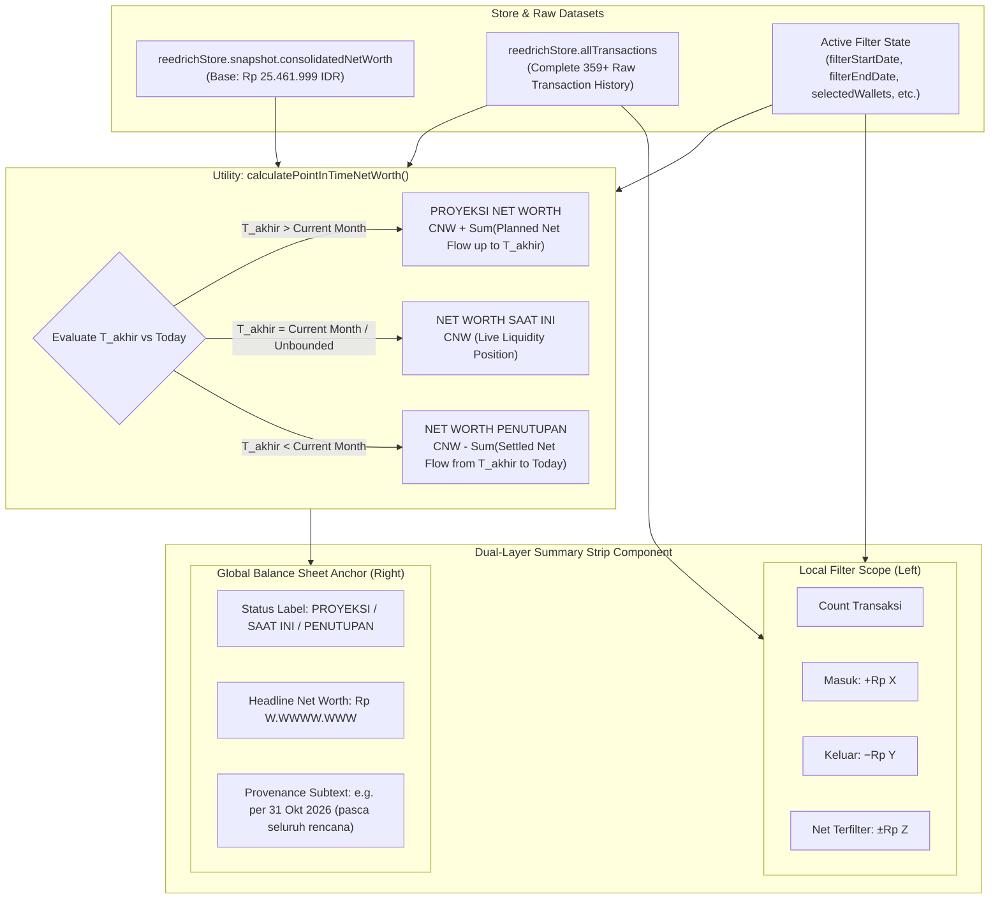

# Design: Ledger Dual-Layer Net Worth Anchor

## Context

The current `/ledger` route calculates financial aggregates strictly from filtered transactions (`filteredTransactions`), computing `count`, `income`, `expense`, and `net = income - expense`. When the user filters for "Bulan Depan", planned expenses (such as house rent, tuition, or vehicle installments) without recorded future income yield a negative periodic cashflow (e.g. `−Rp 5.200.000`). Without balance sheet context, this sends a false alarm of insolvency, even though the user's multi-wallet consolidated net worth (Rp 25.461.999) comfortably absorbs the planned commitments.

See `proposal.md` for background and problem motivation.

## Goals / Non-Goals

**Goals:**
- Implement a **Dual-Layer Summary Strip** in `src/routes/ledger/+page.svelte`:
  - **Left Layer (Local Filter Scope)**: Reactive metrics reflecting solely the filtered subset (transaction count, sum of inflows, sum of outflows, net filtered cashflow).
  - **Right Layer (Global Point-in-Time Net Worth Anchor)**: Reactive portfolio net worth anchored to the filter's ending horizon date ($T_{\text{akhir}}$).
- Encapsulate the point-in-time calculation into an isolated, pure mathematical utility `calculatePointInTimeNetWorth()` in `src/lib/utils/networth-timeline.ts` to ensure 100% testability.
- Provide a clean, utilitarian UI compliant with `minimalist-ui` (no tooltips, direct uppercase tracking labels, monospaced tabular numbers, muted contextual provenance subtexts).
- Ensure responsive parity across desktop ($\ge 1024\text{px}$) and mobile ($< 1024\text{px}$).

**Non-Goals:**
- Modifying backend Cloudflare Worker edge endpoints or schema.
- Changing Cockpit home page KPI cards or Account Matrix calculations.
- Introducing bank-level multi-currency exchange rate fluctuation forecasting (rates remain pegged to current snapshot FX).

## Architecture & Data Flow

## Mathematical Invariants & Horizon Logic

Let:
- $NW_{\text{current}}$ be the live consolidated net worth in IDR (`reedrichStore.snapshot.consolidatedNetWorth.total`).
- $T_{\text{today}}$ be the current date in ISO format (`YYYY-MM-DD`, e.g., `2026-09-24`).
- $T_{\text{startMonth}}$ be the first day of the current calendar month (`2026-09-01`).
- $T_{\text{endMonth}}$ be the last day of the current calendar month (`2026-09-30`).
- $T_{\text{akhir}}$ be the upper bound date of the active date filter (`filterEndDate`).

### 1. Future Horizon ($T_{\text{akhir}} > T_{\text{endMonth}}$)
- **Label**: `PROYEKSI NET WORTH`
- **Formula**:
  $$NW_{\text{projected}} = NW_{\text{current}} + \sum_{\substack{t \in \text{allTransactions} \\ t.\text{date} > T_{\text{today}} \\ t.\text{date} \le T_{\text{akhir}}}} \Delta(t)$$
  where $\Delta(t) = +t.\text{amount}$ if income, $-t.\text{amount}$ if expense.
- **Provenance Subtext**: `proyeksi per [T_akhir] (pasca seluruh rencana)`

### 2. Present / Current Month / All-Time ($T_{\text{akhir}}$ is within current month or empty)
- **Label**: `NET WORTH SAAT INI`
- **Formula**:
  $$NW_{\text{present}} = NW_{\text{current}}$$
- **Provenance Subtext**: `posisi likuiditas terkonsolidasi`

### 3. Historical Past Horizon ($T_{\text{akhir}} < T_{\text{startMonth}}$)
- **Label**: `NET WORTH PENUTUPAN`
- **Formula**:
  $$NW_{\text{closing}} = NW_{\text{current}} - \sum_{\substack{t \in \text{allTransactions} \\ t.\text{date} > T_{\text{akhir}} \\ t.\text{date} \le T_{\text{today}}}} \Delta(t)$$
- **Provenance Subtext**: `posisi saldo per [T_akhir] (penutupan historis)`

## Responsive UI Specification

### Desktop Layout ($\ge 1024\text{px}$)
- Container: `flex items-center justify-between gap-6 rounded-lg border border-[#EAEAEA] bg-white p-3.5 shadow-2xs`
- Left Zone: `flex items-center gap-4 text-xs font-mono tabular-nums` (Count badge + Masuk + Keluar + Net Terfilter)
- Right Zone: `flex flex-col items-end border-l border-[#EAEAEA] pl-5 text-right`
  - Overline label: `text-[10px] font-semibold uppercase tracking-wider text-[#787774]`
  - Headline number: `text-sm font-bold font-mono text-[#111111]`
  - Provenance text: `text-[10px] text-[#787774]`

### Mobile Layout ($< 1024\text{px}$)
- Container: `flex flex-col gap-3 rounded-lg border border-[#EAEAEA] bg-white p-3 shadow-2xs`
- Left Zone: Full-width wrapped row displaying filter metrics.
- Right Zone: Full-width panel separated by `border-t border-[#EAEAEA] pt-2.5 flex items-center justify-between text-left`.

## Testing Strategy

1. **Unit Tests (Vitest) in `src/lib/utils/networth-timeline.test.ts`**:
   - Verify future horizon returns correct planned addition/deduction from baseline Net Worth.
   - Verify current month / all-time returns baseline Net Worth without distortion.
   - Verify past horizon reconstructs historical closing Net Worth by subtracting post-cutoff transactions.
   - Verify category/wallet filter narrowing does not mutate the timeline calculation inputs.

2. **End-to-End Tests (Playwright) in `tests/ledger-dual-layer.spec.ts`**:
   - Test navigating to `/ledger` with default "Bulan Ini" preset renders `NET WORTH SAAT INI` in right zone.
   - Test switching date picker preset to "Bulan Depan" renders `PROYEKSI NET WORTH` with positive/reassuring balance.
   - Test selecting category "Makan & Minum" updates the left zone transaction count and net flow, while right zone retains full portfolio Net Worth projection.
   - Test mobile viewport layout responsiveness and visual integrity.
