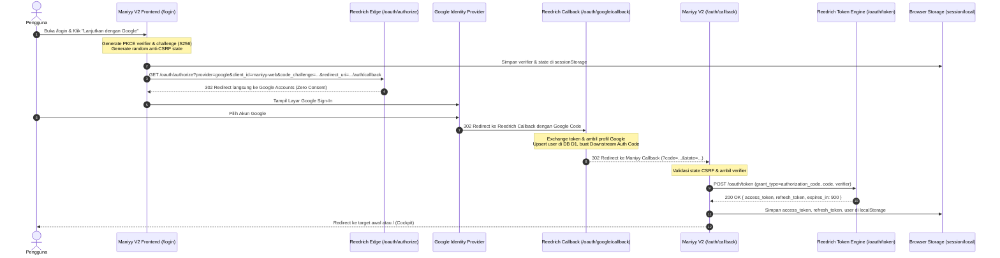
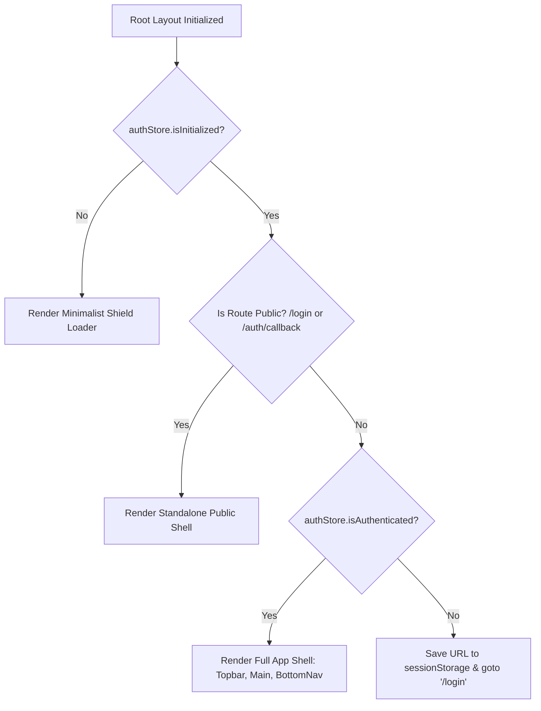

# Design: Google OAuth 2.0 PKCE & Persistent Date Filter

## Context

Maniyy V2 is an offline-resilient, static SPA built with Svelte 5 and SvelteKit (`adapter-static`, `ssr = false`) deployed to Cloudflare Pages. See `proposal.md` for motivation. The application currently loads data using a static token in `.env`. With Reedrich Edge v1.6.0 introducing `GET /oauth/authorize?provider=google`, the app can securely authenticate users via standard OAuth 2.0 PKCE S256 without intermediate consent forms.

## Goals / Non-Goals

**Goals:**
- Provide a dedicated, distraction-free `/login` experience adhering strictly to `minimalist-ui` (warm bone `#F7F6F3`, pure white card, serif typography, 1px `#EAEAEA` borders, no emojis, no neon gradients).
- Implement client-side RFC 7636 PKCE using native Web Crypto (`crypto.subtle`) without third-party OAuth SDK bloat.
- Provide a dual-layer auth guard: layout-level routing guard with anti-FOUC shield and API-level 401 refresh interceptor.
- Maintain a single source of truth for date range filters (`dateFilterStore`) synced to `localStorage`, preserving user selection across route transitions and browser refreshes until an explicit reset, manual edit, or logout occurs.
- Enable smooth return to deep-linked URLs after Google Sign-In completes.

**Non-Goals:**
- Managing Google OAuth credentials or server-side OAuth callback handling (handled entirely by Reedrich Edge worker at `/oauth/google/callback`).
- Multi-tenant credential switching or social providers other than Google (Reedrich v1.6.0 focuses on Google).
- Backend session cookie management (static SPA relies on stateless JWT Bearer tokens).

## Architecture & Data Flow

## Decisions

### 1. Web Crypto API for PKCE Generation
- **Decision**: Use `window.crypto.getRandomValues()` and `window.crypto.subtle.digest('SHA-256', ...)` to generate the 64-character URL-safe `code_verifier` and base64url-encoded `code_challenge`.
- **Rationale**: Completely native to all modern browsers, zero bundle size overhead, zero supply-chain risk.

### 2. Dual-Layer Storage Strategy
- **Decision**: 
  - `sessionStorage` for transient handshake tokens (`reedrich_pkce_verifier`, `reedrich_oauth_state`, `reedrich_auth_target`).
  - `localStorage` for persistent session state (`reedrich_access_token`, `reedrich_refresh_token`, `reedrich_expires_at`, `reedrich_user`) and persistent filter state (`maniyy_date_filter`).
- **Rationale**: Verifier is cleared immediately after callback code exchange, mitigating replay vectors. Long-term session tokens remain available across tab closures.

### 3. Anti-FOUC Layout Guard Architecture
- **Decision**: Render an initializing shield (`!authStore.isInitialized`) in `src/routes/+layout.svelte` while reading `localStorage`. Render a public shell for `/login` and `/auth/callback` (isolated from Topbar, BottomNav, and studio navigation), and the standard app shell for authenticated routes.
- **Rationale**: Completely prevents momentary flickering of private financial data before redirecting unauthenticated users.

### 4. Reactive Date Filter Store (`dateFilterStore`)
- **Decision**: Implement `dateFilterStore` as a Svelte 5 reactive class wrapping `$state`. 
  - `preset`: `'this_month' | 'next_month' | 'last_month' | 'today' | 'all' | 'custom'`
  - `startDate`: string (`YYYY-MM-DD`)
  - `endDate`: string (`YYYY-MM-DD`)
- **Persistence**: Persisted to `localStorage` key `maniyy_date_filter` on every mutation.
- **Reset Invariant**: State is only reset to current month default when:
  1. User clicks the "Reset Filter" button in the UI.
  2. User manually selects another date or preset via `DateRangePicker`.
  3. User logs out of the application.

## Layout & Component Hierarchy

### Desktop Layout ($\ge 1024\text{px}$)
- `/login`: Centered bento-style card (`max-w-md`), warm bone canvas (`#F7F6F3`), white card surface (`#FFFFFF`), 1px `#EAEAEA` border.
- Topbar: Displays authenticated user initials avatar, user email, and dropdown with "Keluar" (Logout).

### Mobile Layout ($< 1024\text{px}$)
- `/login`: Full-width padded card with generous touch targets ($\ge 44\text{px}$).
- Topbar: Compact avatar icon triggering clean mobile drawer or popover with logout action.

## Test Strategy

### Unit Tests (Vitest)
1. **PKCE Crypto Helpers (`pkce.test.ts`)**:
   - Verify code verifier meets RFC 7636 character set and length constraints (43..128 chars).
   - Verify SHA-256 challenge generation matches standard vectors.
2. **AuthStore Lifecycle (`auth.test.ts`)**:
   - Test login state persistence to `localStorage`.
   - Test proactive refresh calculation when token is within 60s of expiration.
   - Test logout purging all keys from `localStorage`.
3. **DateFilterStore Persistence (`date-filter.test.ts`)**:
   - Verify initialization loads stored filter from `localStorage`.
   - Verify changing date persists to storage.
   - Verify reset returns to `this_month` and purges storage.

### End-to-End Tests (Playwright)
1. **Unauthenticated Redirection (`tests/auth-guard.spec.ts`)**:
   - Visiting `/ledger` or `/accounts` without tokens redirects to `/login`.
   - Visiting `/login` shows the "Lanjutkan dengan Google" CTA and minimalist UI styling.
2. **OAuth Callback Simulation (`tests/auth-callback.spec.ts`)**:
   - Simulate arrival at `/auth/callback?code=mock_code&state=mock_state`.
   - Verify token storage and navigation to the deep-linked route.
3. **Persistent Date Filter (`tests/persistent-filter.spec.ts`)**:
   - Switch date to "Bulan Depan" on `/ledger`.
   - Navigate to `/accounts` via BottomNav; verify date picker still shows "Bulan Depan".
   - Reload page; verify date picker still shows "Bulan Depan".
   - Click "Reset Filter"; verify date picker returns to "Bulan Ini".
