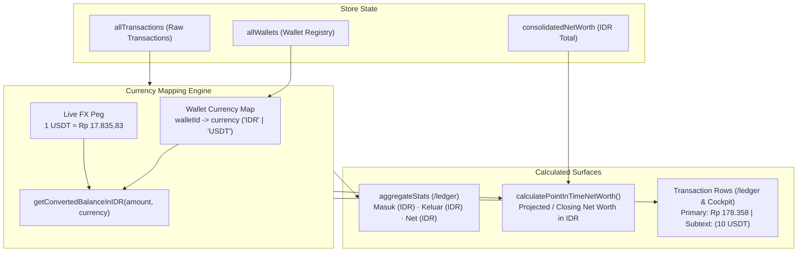

# Design: Ledger Multi-Currency IDR Unification

## Context

The application manages both IDR-denominated accounts (BCA, Bank Jago, OCBC, GoPay, Cash) and foreign-currency accounts (Bitget holding USDT). In `src/lib/utils/networth-timeline.ts` and `src/routes/ledger/+page.svelte`, transaction calculations currently sum raw `transactionAmount` values directly. For transactions originating from non-IDR wallets, this creates a severe dimensional error where 1 USDT is counted as 1 IDR instead of its live peg valuation (~Rp 17.835,83).

See `proposal.md` for background and user outcomes.

## Goals / Non-Goals

**Goals:**
- Unify all ledger aggregates (`Masuk`, `Keluar`, and `Net Terfilter`) to Indonesian Rupiah (IDR) using the centralized `getConvertedBalanceInIDR()` utility.
- Ensure `calculatePointInTimeNetWorth()` in `src/lib/utils/networth-timeline.ts` resolves wallet currencies and computes all future deltas and historical adjustments in IDR.
- Harmonize transaction row displays in both desktop tables and mobile feeds: primary amount rendered in converted IDR (`fmtIDR()`), with native currency amount displayed as secondary subtext (e.g. `(10 USDT)`) for non-IDR accounts.
- Provide comprehensive test coverage in Vitest and Playwright ensuring currency conversions are verified.

**Non-Goals:**
- Modifying backend Cloudflare Worker edge schemas.
- Real-time live exchange rate ticker streaming (rates remain pegged to the current snapshot FX rate).

## Architecture & Currency Resolution



## Detailed Mathematical & Component Specifications

### 1. `calculatePointInTimeNetWorth()` in `src/lib/utils/networth-timeline.ts`
- **Updated Signature**:
  ```typescript
  export function calculatePointInTimeNetWorth(params: {
    currentNetWorth: number;
    allTransactions: TransactionRecord[];
    endDate?: string | null;
    referenceDate?: string;
    walletCurrencyMap?: Map<string, string> | Record<string, string>;
    customRates?: Record<string, number>;
  }): PointInTimeNetWorthResult
  ```
- **Conversion Rule**:
  For each transaction $t$:
  $$\text{curr} = \text{walletCurrencyMap}[t.\text{transactionWalletId}] \parallel \text{'IDR'}$$
  $$\Delta_{\text{IDR}} = \text{getConvertedBalanceInIDR}(t.\text{transactionAmount}, \text{curr}, \text{customRates})$$
  Add or subtract $\Delta_{\text{IDR}}$ instead of raw `t.transactionAmount`.

### 2. `aggregateStats` in `src/routes/ledger/+page.svelte`
- Inside `$derived.by()`:
  For each filtered transaction $t$:
  $$\text{curr} = \text{getWalletCurrency}(t.\text{transactionWalletId})$$
  $$\text{amtIDR} = \text{getConvertedBalanceInIDR}(t.\text{transactionAmount}, \text{curr})$$
  Accumulate `inSum += amtIDR` or `outSum += amtIDR`.
  `net = inSum - outSum`.

### 3. Row Amount Rendering (`/ledger` and `CockpitRecentLedger`)
- **Desktop Table Cell**:
  ```svelte
  {@const curr = getWalletCurrency(t.transactionWalletId)}
  {@const amtIDR = getConvertedBalanceInIDR(t.transactionAmount, curr)}
  <div class="font-mono font-semibold whitespace-nowrap tabular-nums {color}">
    {sign}{fmtIDR(amtIDR)}
  </div>
  {#if curr !== 'IDR'}
    <div class="font-mono text-[9px] text-[#787774] tabular-nums">
      ({fmtCurrency(t.transactionAmount, curr)})
    </div>
  {/if}
  ```
- **Mobile Dense Row**:
  Same pattern on the right side of line 1: primary IDR amount with font-bold, secondary native notation underneath.

## Testing Strategy

1. **Unit Tests (Vitest) in `src/lib/utils/networth-timeline.test.ts`**:
   - Add test case with non-IDR USDT transactions (e.g. 50 USDT planned expense).
   - Verify future projected Net Worth deducts $50 \times 17.835,8258 \approx \text{Rp } 891.791$ from baseline Net Worth rather than Rp 50.
   - Verify historical closing balance adjusts for past non-IDR transactions using exchange rate.
2. **End-to-End Tests (Playwright) in `tests/ledger-multi-currency.spec.ts`**:
   - Verify non-IDR transactions display converted IDR amounts in table and mobile feed.
   - Verify ledger summary strip correctly sums converted IDR values.
