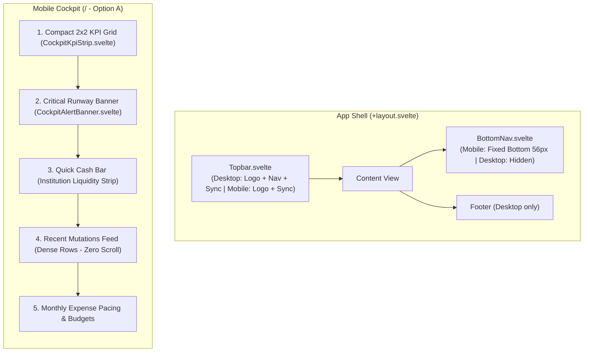

# Design: Mobile UX Refinement

## Context

The existing interface is fluidly responsive across viewports via Tailwind flex-wrapping and horizontal overflow containers. However, it still reflects strong desktop-first assumptions when viewed on mobile screens (< 768px):
- Primary navigation is squeezed into an overflow-x rail at the very top of the screen, out of reach of one-handed thumb interaction.
- Transaction ledgers (`/ledger` and Cockpit `Mutasi Terkini`) rely on multi-column tables with `overflow-x-auto`, requiring awkward horizontal swiping to read essential transaction amounts.
- Cockpit home route (`/`) stacks 15+ individual bank accounts in full detail, pushing recent transactions and budget pacing far down the page.

See `proposal.md` for background and user outcomes.

## Goals / Non-Goals

**Goals:**
- Provide a dedicated, sticky **Bottom Navigation Bar** (`BottomNav.svelte`) on mobile viewports (< 768px) with 4 key studios in the natural thumb zone (`Cockpit`, `Ledger`, `Akun & Bank`, `Perencanaan`).
- Implement a **Dual-Presentation Model** for transaction lists: full spreadsheet table on desktop (`md:` and above) vs flat, zero-horizontal-scroll **Dense Transaction Rows** on mobile.
- Implement **Option A Cockpit Hierarchy**: 2x2 compact KPI grid on top, followed by a streamlined single-row **Quick Cash Bar** linking to `/accounts`, leading immediately into the Recent Mutations feed.
- Ensure all touch targets on mobile meet comfortable accessibility standards ($\ge 40\text{px}$).
- Maintain strict compliance with `minimalist-ui`: flat document-style aesthetic, pure white `#FFFFFF` cards, warm bone `#F7F6F3` background, 1px `#EAEAEA` borders, zero nested cards, no heavy shadows.

**Non-Goals:**
- Modifying backend Cloudflare Worker edge endpoints or data schemas.
- Changing desktop navigation or multi-column layouts on viewports $\ge 768\text{px}$.
- Introducing swipe gestures or bottom modal sheets (slide-over drilldown drawers remain standard).

## Component Hierarchy & Layout Shell



## Detailed Responsive Layout Specifications

### 1. Sticky Bottom Navigation Bar (`BottomNav.svelte`)
- **Container**: `fixed bottom-0 left-0 right-0 z-40 h-14 border-t border-[#EAEAEA] bg-white/95 backdrop-blur-xs md:hidden`
- **Grid / Flex**: 4 equal flex items distributed across the viewport width.
- **Item Affordance**:
  - Height: `56px`, touch target area `w-full h-full flex flex-col items-center justify-center gap-0.5`.
  - Icon: Phosphor Bold `size-4.5`.
  - Label: `text-[10px] font-medium tracking-tight`.
  - Inactive State: `text-[#787774]`.
  - Active State: `text-[#111111] font-semibold` with a subtle micro-dot (`size-1 rounded-full bg-[#111111]`) below the label.
- **Topbar Synchronization**: On mobile, `Topbar.svelte` hides `<nav>` (`hidden md:flex`), keeping only the brand mark on the left and Live/Mock pill on the right.

### 2. Dual-Presentation Dense Transaction Rows
In both `src/routes/ledger/+page.svelte` and `src/lib/components/cockpit/CockpitRecentLedger.svelte`:
- **Desktop Template (`hidden md:table`)**: Full table with 8 columns, headers, alternating row tints, and monospaced right-aligned amounts.
- **Mobile Template (`md:hidden divide-y divide-[#EAEAEA]`)**:
  ```html
  <div class="p-3 transition-colors hover:bg-[#FBFBFA]">
    <!-- Primary Line: Description + Amount -->
    <div class="flex items-start justify-between gap-2">
      <div class="font-medium text-xs text-[#111111] line-clamp-1">{desc}</div>
      <div class="font-mono text-xs font-bold whitespace-nowrap text-right tabular-nums {color}">
        {sign}{fmtIDR(amount)}
      </div>
    </div>
    <!-- Secondary Line: Date · Category Tag · Routing -->
    <div class="mt-1 flex items-center justify-between text-[11px] text-[#787774]">
      <div class="flex items-center gap-1.5 truncate">
        <span>{dFmt(date)}</span>
        <span>·</span>
        <span class="rounded bg-[#F0EFEC] px-1.5 py-0.2 font-medium text-[10px] text-[#111111]">{category}</span>
        <span>·</span>
        <span class="truncate">{sourceAccount}{targetAccount ? ` → ${targetAccount}` : ''}</span>
      </div>
      {#if isPlanned}
        <span class="font-mono text-[9px] uppercase text-[#956400]">Planned</span>
      {/if}
    </div>
  </div>
  ```
- **Zero Horizontal Scroll**: All critical information is immediately visible without swiping right.

### 3. Option A Cockpit Hierarchy
In `src/routes/+page.svelte` and subcomponents:
- **Top KPI Grid (`CockpitKpiStrip.svelte`)**:
  - Mobile: `grid grid-cols-2 gap-2.5 sm:grid-cols-2 lg:grid-cols-4`
  - Compact padding (`p-3`), text scale `text-base sm:text-xl`.
- **Cockpit Bank Widget (`CockpitBankWidget.svelte`)**:
  - Desktop: Full sidebar widget with list of bank accounts and subtotals.
  - Mobile: Renders as a sleek, horizontal **Quick Cash Bar**:
    - Header: Bank icon + "Likuiditas Akun" + link to `/accounts` ("Lihat Semua →").
    - Body: Horizontal scroll rail of pill summaries (`BCA: Rp 8,9M`, `Jago: Rp 4,8M`, `OCBC: Rp 959rb`, `Bitget: 115.61 USDT`).
- **Recent Mutations (`CockpitRecentLedger.svelte`)**:
  - Placed directly after the Quick Cash Bar on mobile, giving instant priority to recent financial activity.

## Testing Strategy

1. **Unit Tests (Vitest)**:
   - Verify layout and store reactivity across viewport-specific component states.
   - Verify active route matching logic for bottom navigation links.

2. **End-to-End Tests (Playwright) in `tests/mobile-ux.spec.ts`**:
   - Set mobile viewport (`375x667` and `390x844`).
   - Verify `BottomNav` is visible with all 4 items and navigates correctly to `/`, `/ledger`, `/accounts`, and `/planning`.
   - Verify `Topbar` nav links are hidden on mobile and visible on desktop (`1280x800`).
   - Verify `/ledger` renders mobile dense rows with zero horizontal scroll (`overflow-x` container does not overflow).
   - Verify Cockpit displays 2x2 KPI grid and Quick Cash Bar above recent mutations.
