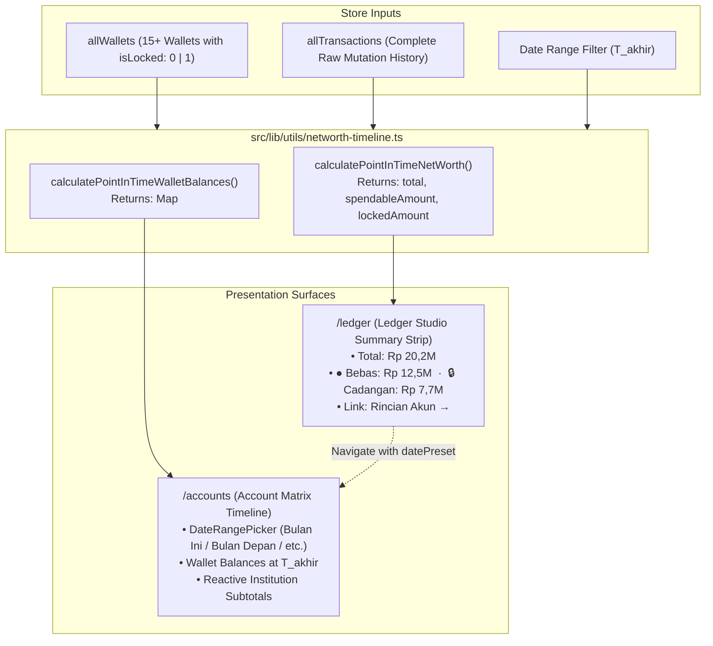

# Design: Net Worth Breakdown & Accounts Timeline

## Context

The application now supports currency-aware point-in-time Net Worth calculations in the Ledger Studio (`/ledger`). However, the global balance sheet anchor currently displays only the aggregate total, leaving users unaware of the underlying liquidity composition (how much is immediately spendable operational cash vs. locked reserves). Furthermore, the Account Matrix (`/accounts`) displays static current wallet balances without timeline projection capabilities, preventing users from seeing where money will reside at future dates or where it stood at historical cutoffs.

See `proposal.md` for background and user outcomes.

## Goals / Non-Goals

**Goals:**
- Extend `calculatePointInTimeNetWorth()` in `src/lib/utils/networth-timeline.ts` to return `spendableAmount` and `lockedAmount` across all timeline horizons (future projections, current liquidity, and historical closing balances).
- Display the Spendable vs. Locked breakdown in `/ledger`:
  - **Desktop ($\ge 1024\text{px}$)**: Displayed directly as an elegant monospaced line (`● Bebas: Rp X · 🔒 Cadangan: Rp Y`) with an interactive `Rincian Akun →` navigation shortcut.
  - **Mobile ($< 1024\text{px}$)**: Displayed as an always-visible, zero-click compact 2-column bar directly below the total amount.
- Transform `/accounts` into a dynamic **Balance Sheet Timeline Studio**:
  - Integrate the custom 2-click `DateRangePicker` component into the `/accounts` control bar.
  - Implement `calculatePointInTimeWalletBalances()` to calculate exact timeline balances for every individual wallet at $T_{\text{akhir}}$ (accounting for planned incomes, expenses, and intra-wallet transfers).
  - Dynamically recompute institution subtotals, spendable/locked totals, and grand totals to match the selected date horizon.
  - Support pre-filtering via URL parameter (`/accounts?datePreset=...`), allowing seamless transition from `/ledger` to `/accounts`.

**Non-Goals:**
- Modifying backend Cloudflare Worker edge API schemas or database tables.
- Replacing existing `/accounts` filter toggles (`[Semua]`, `[Operasional]`, `[Cadangan]`).

## Architecture & Data Flow

## Mathematical Model & Transfer Invariants

Let $W$ be the set of all wallets. Each wallet $w \in W$ has an initial balance $B_w$, currency $C_w$, and status $L_w \in \{0, 1\}$ ($0 = \text{spendable}$, $1 = \text{locked}$).

For any transaction $t$ occurring between today and horizon $T_{\text{akhir}}$:
- Let $amt_{\text{IDR}} = \text{getConvertedBalanceInIDR}(t.\text{amount}, C_{w})$.
- If $t.\text{type} == \text{'income'}$: source wallet balance increases ($+t.\text{amount}$).
- If $t.\text{type} == \text{'expense'}$: source wallet balance decreases ($-t.\text{amount}$).
- If $t.\text{type} == \text{'transfer'}$:
  - Source wallet $t.\text{walletId}$ decreases: $-t.\text{amount}$.
  - Target wallet $t.\text{targetWalletId}$ increases: $+t.\text{amount}$.
  - If transferring between a spendable wallet and a locked wallet, the respective category totals adjust accordingly while total net worth remains invariant.

### Mathematical Invariant:
$$\sum_{w \in W} \text{converted}(B_{w}(T_{\text{akhir}})) \equiv NW_{\text{projected}}(T_{\text{akhir}})$$
$$\sum_{w \in W, L_w=0} \text{converted}(B_{w}(T_{\text{akhir}})) \equiv NW_{\text{spendable}}(T_{\text{akhir}})$$
$$\sum_{w \in W, L_w=1} \text{converted}(B_{w}(T_{\text{akhir}})) \equiv NW_{\text{locked}}(T_{\text{akhir}})$$

The sum of all individual projected wallet balances in `/accounts` will strictly equal the global anchor and breakdown in `/ledger`.

## Component & UI Specifications

### 1. Ledger Right Zone (`src/routes/ledger/+page.svelte`)
- **Desktop ($\ge 1024\text{px}$)**:
  - Overline: `text-[10px] font-semibold uppercase tracking-wider text-[#787774]` (e.g. `PROYEKSI NET WORTH`)
  - Headline: `text-sm font-bold font-mono text-[#111111] tabular-nums` (e.g. `Rp 20.261.999`)
  - Breakdown line:
    - `● Bebas: Rp 12.500.000` (green dot `#346538`)
    - `·`
    - `🔒 Cadangan: Rp 7.761.999` (amber lock `#956400`)
  - Subtext line:
    - Provenance date text e.g. `per 31 Okt 2026 (pasca seluruh rencana)`
    - Action link: `<a href="/accounts?datePreset={datePreset}" class="underline hover:text-[#111111]">Rincian Akun →</a>`
- **Mobile ($< 1024\text{px}$)**:
  - Preserves vertical alignment. Under the headline number, renders a compact 2-column flex row showing Bebas and Cadangan with micro icons, plus the `Rincian Akun →` link.

### 2. Accounts Control Bar & Dynamic Balances (`src/routes/accounts/+page.svelte`)
- Add `<DateRangePicker bind:start={filterStartDate} bind:end={filterEndDate} bind:preset={datePreset} onchange={recalculateTimeline} />` into the controls bar alongside search, status filter, sort, and view mode.
- Wallet balances render:
  $$\text{balanceAtHorizon} = \text{timelineWalletBalances}.\text{get}(w.\text{walletId}) \parallel w.\text{balance}$$
- Institution subtotals and top totals recompute reactively from `balanceAtHorizon`.

## Testing Strategy

1. **Unit Tests (Vitest) in `src/lib/utils/networth-timeline.test.ts`**:
   - Test `calculatePointInTimeNetWorth()` returns accurate `spendableAmount` and `lockedAmount` across future, present, and past horizons.
   - Test intra-wallet transfers (spendable to locked and locked to spendable) correctly adjust spendable vs. locked amounts.
   - Test `calculatePointInTimeWalletBalances()` computes exact per-wallet balances matching global net worth.
2. **End-to-End Tests (Playwright) in `tests/accounts-timeline.spec.ts`**:
   - Test clicking `Rincian Akun →` in `/ledger` navigates to `/accounts` with matching date preset.
   - Test changing date preset to "Bulan Depan" in `/accounts` updates individual wallet balances and institution subtotals.
   - Test mobile viewport layout integrity.
