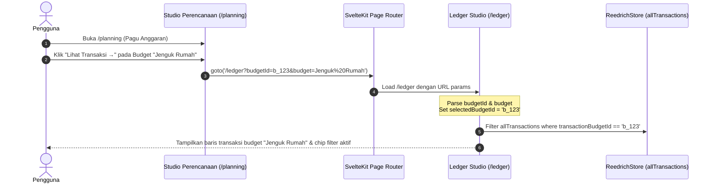

# Design: Budget Filtering & Cross-Studio Planning Drilldown

## Context

In Maniyy V2, users track budgets and financial targets in `/planning`, but cannot view the specific mutations that comprise those totals. See `proposal.md` for motivation. The backend transaction model already includes `transactionBudgetId: string | null`, and the app already has `reedrichStore.activeBudgets` loaded from `GET /api/v1/account-detail`.

## Goals / Non-Goals

**Goals:**
- Provide a responsive Searchable Combobox for Budgets in the Ledger Studio (`/ledger`) alongside Wallets and Categories.
- Parse `budgetId` and `budget` query parameters on `/ledger` mount and activate the corresponding budget filter.
- Filter transactions in `/ledger` by matching `t.transactionBudgetId === selectedBudgetId` (or fallback to budget category matching when legacy transactions lack explicit budget ID).
- Display a discrete budget badge in desktop and mobile transaction feeds (`src/routes/ledger/+page.svelte`).
- Add clean, utilitarian drilldown links on Budget cards, Savings Goal cards, and Recurring Template rows in `/planning`.

**Non-Goals:**
- Creating or editing budgets in this change (read-only drilldown and filtering first).
- Complex multi-budget composite formulas.

## Architecture & Data Flow

## Decisions

### 1. Unified Budget Combobox in Ledger Filter Bar
- **Decision**: Add a `ComboboxMultiSelect` for Budgets (populated from `reedrichStore.activeBudgets`) to Row 2 of the filter bar in `src/routes/ledger/+page.svelte`.
- **Rationale**: Reuses the proven, accessible multi-select component already used for Wallets and Categories, keeping the interface consistent and predictable.

### 2. Dual Filtering Resolution (Direct ID + Category Fallback)
- **Decision**: When filtering by `selectedBudgetId`:
  - Primary check: `t.transactionBudgetId === selectedBudgetId`
  - Fallback check: if the budget has a linked `categoryId` and `t.transactionBudgetId` is null, match `t.transactionCategoryId === budget.categoryId`.
- **Rationale**: Real-world transactions may have been recorded before explicit budget tagging was added; matching the category ensures historical items still show up under the budget.

### 3. Active Filter Chip with Instant Dismissal
- **Decision**: When `selectedBudgetId` is non-empty, render an inline active filter chip:
  `Budget: Jenguk Rumah [x]`
  Clicking `[x]` clears the budget filter and updates the URL.

### 4. Planning Studio Drilldown Actions
- **Decision**:
  - In `src/lib/components/budgets/BudgetCard.svelte`: add a prominent link `Lihat Transaksi ({b.spentCount || 'Semua'}) →` linking to `/ledger?budgetId=${b.budgetId}&budget=${encodeURIComponent(b.budgetName)}`.
  - In `src/routes/planning/+page.svelte`: add links on goal funding wallets and recurring template rows to view matching mutations in the ledger.

## Test Strategy

### Unit Tests (Vitest)
1. **Budget Filter Matcher (`budget-filter.test.ts`)**:
   - Verify transactions with matching `transactionBudgetId` are included.
   - Verify category fallback matching when `transactionBudgetId` is null.

### End-to-End Tests (Playwright)
1. **Planning-to-Ledger Budget Drilldown (`tests/planning-drilldown.spec.ts`)**:
   - Navigate to `/planning`.
   - Click "Lihat Transaksi →" on a budget card.
   - Verify navigation to `/ledger?budgetId=...`.
   - Verify ledger table displays matching budget transactions and aggregate totals.
   - Verify active filter chip is visible and clicking "x" resets the budget filter.
