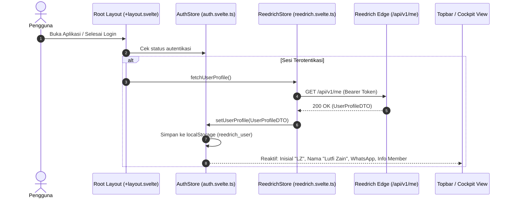

# Design: Reedrich /me User Profile Integration

## Context

With Reedrich v1.8.0 exposing `GET /api/v1/me` and `GET /api/v1/user/profile`, Maniyy V2 can upgrade from heuristic JWT claim parsing to official, verified user profile information. See `proposal.md` for motivation.

## Goals / Non-Goals

**Goals:**
- Provide a typed data contract (`UserProfileDTO`) for user profile data.
- Wire `fetchUserProfile()` through `reedrichStore` using the existing authenticated `request()` pipeline (including proactive token refresh and 401 retry).
- Store complete profile information (`fullName`, `firstName`, `lastName`, `email`, `whatsappNumber`, `createdAt`, `userId`) in `authStore.user` and persist to `localStorage` (`reedrich_user`).
- Enhance `Topbar.svelte` user avatar with accurate two-letter initials and detailed profile dropdown (WhatsApp contact, formatted membership date).
- Personalize Cockpit header with an editorial greeting.

**Non-Goals:**
- Editing or modifying user profile fields on the backend (Reedrich v1.8.0 /me is a read-only endpoint).
- Adding full settings or profile management forms.

## Architecture & Data Flow



## Decisions

### 1. Data Type Contract
- **Decision**: Define `UserProfileDTO` in `src/lib/types/account-detail.ts`:
  ```typescript
  export interface UserProfileDTO {
      userId: string;
      firstName: string;
      lastName: string;
      fullName: string;
      email: string;
      whatsappNumber?: string;
      createdAt: string;
  }
  ```
- **Rationale**: Strict TypeScript typings matching the backend D1 user schema serialization in Reedrich v1.8.0.

### 2. Dual-Trigger Hydration Strategy
- **Decision**: Invoke `reedrichStore.fetchUserProfile()`:
  1. In `src/routes/+layout.svelte` during `onMount()` whenever `authStore.isAuthenticated` is true.
  2. In `src/routes/auth/callback/+page.svelte` immediately after token exchange completes.
- **Rationale**: Guarantees that whether a user loads an existing session or completes a fresh OAuth/API key login, profile details are always up to date.

### 3. Graceful Fallback on Offline / Token Failure
- **Decision**: If `GET /api/v1/me` fails (e.g. offline mode or temporary edge glitch), retain whatever profile was previously persisted in `localStorage` or parsed from JWT claims without throwing an error that blocks dashboard rendering.

## Test Strategy

### Unit Tests (Vitest)
1. **`fetchUserProfile()` Mock Test (`reedrich.test.ts`)**:
   - Verify `fetchUserProfile()` calls `GET /api/v1/me` with correct headers.
   - Verify `authStore.user` is populated with `fullName`, `whatsappNumber`, and `createdAt`.

### End-to-End Tests (Playwright)
1. **Profile Hydration & Topbar Display (`tests/auth-flow.spec.ts`)**:
   - Verify that when logged in, Topbar displays accurate initials and clicking the avatar displays `fullName` and `whatsappNumber`.
