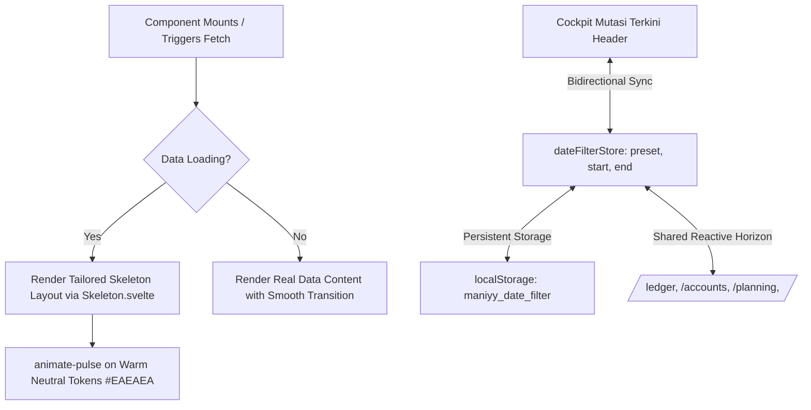

# Design: Shadcn Skeleton Loading States & Cockpit Persistent Date Filter

## Context

Maniyy V2 uses Svelte 5 and Tailwind CSS following `minimalist-ui` guidelines. Currently, data fetching across components either shows crude text loaders ("Memuat transaksi...") or brief blank cards, causing cumulative layout shifts. In addition, the Cockpit Recent Mutations feed is not wired to `dateFilterStore`. See `proposal.md` for motivation.

## Goals / Non-Goals

**Goals:**
- Provide a lightweight, reusable `Skeleton.svelte` primitive adhering to shadcn-svelte style patterns with warm monochrome pulse styling (`bg-[#EAEAEA]`/`bg-[#F0EFEC]`).
- Implement zero-CLS skeleton placeholder layouts for:
  - Cockpit KPI Strip (4 metric cards)
  - Cockpit Bank Accounts widget (institution balances & allocation)
  - Cockpit Recent Ledger (dense mutation feed)
  - Cockpit Cashflow/Allocation widget (category distribution bars)
  - Ledger Studio table and summary strip
  - Akun & Bank wallet matrix
  - Planning Studio workbenches
  - Drawer transaction table
- Connect `CockpitRecentLedger.svelte` directly to `dateFilterStore`, sharing the same persistent date range filter as `/ledger`.

**Non-Goals:**
- Heavy shimmer/skeleton third-party libraries (pure CSS animation with Tailwind `animate-pulse`).
- Blocking user navigation while loading (background hydration without freezing UI).

## Architecture & Data Flow



## Decisions

### 1. Shadcn-Style Skeleton Primitive
- **Decision**: Create `src/lib/components/ui/Skeleton.svelte`:
  ```svelte
  <script lang="ts">
      import { cn } from '$lib/utils/cn';
      let { class: className = '', ...restProps } = $props();
  </script>
  <div
      class={cn('animate-pulse rounded-md bg-[#EFEFED]', className)}
      role="status"
      aria-label="Loading..."
      {...restProps}
  ></div>
  ```
- **Rationale**: Minimal, flexible, accessible, zero-dependency primitive that can be styled with any Tailwind width/height utility classes.

### 2. Tailored Skeleton Component Layouts
- **Decision**: Rather than generic spinners, each widget builds its own skeleton structure matching exact card, row, and column geometries:
  - `CockpitKpiStrip`: 4 cards with label skeleton (`w-20 h-3`), value skeleton (`w-32 h-6`), and subtext skeleton (`w-24 h-2.5`).
  - `CockpitRecentLedger`: 5 rows with description skeleton (`w-40 h-3`), timestamp skeleton (`w-16 h-2`), and amount skeleton (`w-20 h-4`).
  - `Ledger`: 8 table rows with alternating skeleton columns.

### 3. Cockpit Mutasi Terkini Date Filter Integration
- **Decision**: In `CockpitRecentLedger.svelte`:
  - Bind `DateRangePicker` to `dateFilterStore.startDate`, `dateFilterStore.endDate`, `dateFilterStore.preset`.
  - Add inline Reset button (`dateFilterStore.reset()`) when `dateFilterStore.preset !== 'this_month'`.
  - Filter recent mutations reactively:
    `if (dateFilterStore.startDate && txDate < dateFilterStore.startDate) return false;`
    `if (dateFilterStore.endDate && txDate > dateFilterStore.endDate) return false;`

## Test Strategy

### Unit Tests (Vitest)
1. **Skeleton Rendering (`skeleton.test.ts`)**:
   - Verify `Skeleton.svelte` renders with `role="status"` and `animate-pulse` class.
   - Verify custom classes merge properly via `cn()`.

### End-to-End Tests (Playwright)
1. **Cockpit Date Range Sync (`tests/cockpit-date-filter.spec.ts`)**:
   - Change date filter to "Bulan Depan" in `/ledger`.
   - Navigate to `/` (Cockpit); verify Mutasi Terkini header shows "Bulan Depan" and displayed transactions fall within that month.
   - Click "Reset" on Cockpit; verify filter returns to "Bulan Ini" across both Cockpit and `/ledger`.
