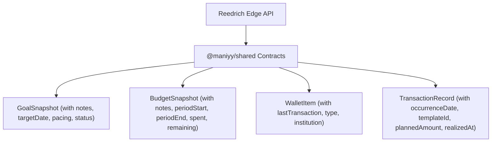
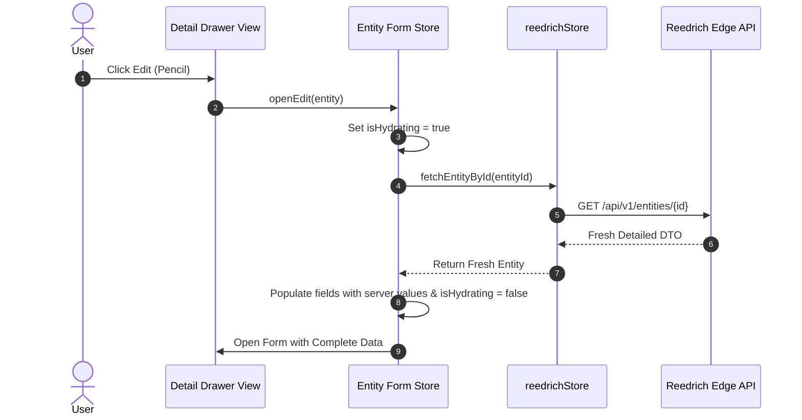

# Design

## Context
See `proposal.md` for background and motivation.

The application currently relies on a centralized `GET /api/v1/account-detail` payload stored in `reedrichStore.snapshot`. While this provides an instant initial load, it flattens entity structures and drops fields like `notes`, `pacing`, and period ranges. Furthermore, the UI lacks temporal lifecycle classification for overdue goals and expired budgets, and exhibits minor design system non-compliances (missing `.serif` CSS class, heavy drop shadows, and category emojis).

## Goals / Non-Goals

**Goals:**
- Provide standalone and by-ID fetchers for Goals, Budgets, Wallets, and Transactions.
- Implement server hydration before editing with an instant-feel skeleton state.
- Render complete metadata in drawer views (target notes, target date, pacing metrics, period dates, origin recurring templates).
- Establish an entity lifecycle engine with visual status badges and segmented filters on `/planning`.
- Achieve 100% compliance with `minimalist-ui`: define `.serif` font rules, convert heavy drop shadows to ultra-diffuse shadows, and replace category emojis with Phosphor SVG primitives.

**Non-Goals:**
- Removing the initial `GET /api/v1/account-detail` snapshot (it remains necessary for Cockpit macro KPI calculations and instant first paint).
- Modifying backend endpoints or database schemas (Reedrich edge API already supports all requested fields and query parameters).
- Implementing full CRUD for Debts and Loans (deferred to a dedicated obligations change).

## Decisions

### 1. Data Contract & DTO Normalization (`packages/shared`)
We ensure that the TypeScript interfaces in `@maniyy/shared` represent the complete backend payloads:



- **Decision**: Update `packages/shared/src/account-detail.ts` so `GoalSnapshot` contains `notes?: string | null`, `targetDate?: string | null`, `pacing?: GoalPacingDTO`, and `status?: 'in_progress' | 'completed' | 'cancelled'`. Ensure `BudgetSnapshot` contains `periodStart?: string`, `periodEnd?: string`, and `notes?: string | null`.

### 2. Store Architecture: Standalone & By-ID Fetching
In `reedrich.svelte.ts`, we implement dedicated fetchers using the existing authenticated `this.request()` pipeline:
- `fetchGoalById(goalId: string): Promise<GoalSnapshot>`
- `fetchBudgetById(budgetId: string): Promise<BudgetSnapshot>`
- `fetchWalletById(walletId: string): Promise<WalletItem>`
- `fetchTransactionById(transactionId: string): Promise<TransactionRecord>`
- `fetchGoals(status?: string): Promise<GoalSnapshot[]>`
- `fetchBudgets(): Promise<BudgetSnapshot[]>`

### 3. Server Hydration & Drawer Architecture
When a user clicks edit (or opens a detailed inspection), we implement the **Fetch-on-Edit (Lazy Detail)** pattern:



### 4. Lifecycle Evaluation Engine (`$lib/utils/lifecycle.ts`)
A centralized utility deterministically resolves status based on financial and temporal criteria:
- **Goal Status**:
  - `completed`: `currentAmount >= targetAmount || status === 'completed'`
  - `overdue`: `targetDate < today && currentAmount < targetAmount`
  - `in_progress`: `targetDate >= today && currentAmount < targetAmount`
  - `long_term`: `targetDate === null && currentAmount < targetAmount`
- **Budget Period Status**:
  - `active_period`: `periodStart <= today && today <= periodEnd`
  - `past_period`: `periodEnd < today`

### 5. Design System Compliance (`minimalist-ui`)
- **Typography**: Add `@utility serif` in `apps/web/src/routes/layout.css`:
  ```css
  .serif {
    font-family: 'Newsreader', 'Playfair Display', 'Instrument Serif', Georgia, serif;
    letter-spacing: -0.025em;
    line-height: 1.15;
  }
  ```
- **Shadow Refinement**: Replace all instances of `shadow-xl`, `shadow-lg`, and `shadow-md` on slide-overs, popovers, and modals with:
  `border border-[#EAEAEA]` and ultra-diffuse ambient shadow `box-shadow: 0 4px 24px rgba(0,0,0,0.03)`.
- **Category Icons**: Replace the emoji picker and default emojis (`🏷️`, `🍔`, `🚗`) with Phosphor icon primitives (`Tag`, `ForkKnife`, `Car`, `Briefcase`, `House`, `ShoppingCart`, etc.).

## Responsive Layout Behavior
- **Desktop (>= 1024px)**:
  - Planning Studio uses an asymmetric 2-column or 3-column bento grid for goal cards and budget cards.
  - Segmented status tabs render inline in the toolbar.
  - Slide-over drawers open at a fixed width of `620px` pinned to the right edge with backdrop blur.
- **Mobile (< 1024px)**:
  - Single-column cards with responsive horizontal overflow prevention.
  - Segmented status filters render as horizontally scrollable pills with count badges.
  - Slide-over drawers expand to `100vw` for maximum readability.

## Test Strategy

### Unit Tests (Vitest)
- Test `lifecycle.ts`: Verify exact evaluation for edge cases:
  - Target date today vs yesterday vs tomorrow
  - Exactly 100% vs 99.9% progress
  - Negative days remaining handling
  - Budget period boundaries (start of month, end of month).
- Test `reedrich.svelte.ts`: Verify `fetchGoalById`, `fetchBudgetById`, `fetchWalletById`, and `fetchTransactionById` call the correct URLs with auth headers and handle network errors gracefully.
- Test form stores (`goal-form`, `budget-form`): Verify hydration updates fields and sets loading flags.

### End-to-End Tests (Playwright)
- `tests/entity-lifecycle.spec.ts`:
  - Verify segmented filtering on `/planning` updates visible goal cards.
  - Verify overdue badge appears on a goal with a past target date.
  - Verify opening goal detail displays the target notes and pacing metrics.
  - Verify clicking edit triggers server hydration and populates form fields.
  - Verify design system compliance: `.serif` font computed style and absence of heavy drop shadows.
