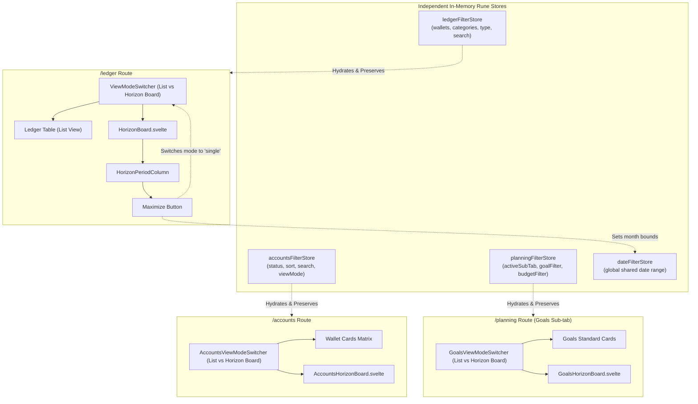

# Design: Multi-Horizon Board and In-Memory Filter Persistence

## Context

The Maniyy V2 architecture utilizes Svelte 5 runes (`$state`, `$derived`, `$effect`) for reactive client state. The multi-period Horizon Board was originally introduced in `/ledger` to provide a bird's-eye view across upcoming calendar months. However, bundling savings goal pacing into ledger columns caused cognitive overload. Furthermore, page-level filters currently live in local component states within `+page.svelte` files, causing filter selections to be destroyed on route changes.

## Goals / Non-Goals

**Goals:**
- Strip goal pacing entirely from `/ledger`'s `PeriodSummaryCard.svelte`.
- Rename "Daftar" to "List" across view switchers for clear and standard terminology.
- Add a Maximize action button to `HorizonPeriodColumn.svelte` that updates `dateFilterStore` to that column's exact month and flips the view mode to `List`.
- Implement `AccountsHorizonBoard.svelte` for `/accounts` displaying point-in-time projected wallet balances and aggregate liquidity.
- Implement `GoalsHorizonBoard.svelte` for `/planning` (scoped to the Goals sub-tab) displaying goal progress, milestone indicators, and monthly pacing.
- Introduce three independent in-memory Svelte 5 rune stores (`ledgerFilterStore`, `accountsFilterStore`, `planningFilterStore`) that preserve user filter states across SPA navigation until page refresh.

**Non-Goals:**
- Persisting filter states to `localStorage` or `sessionStorage` (filters must intentionally reset on browser refresh F5).
- Applying Horizon Board to other Planning sub-tabs like Budgets, Obligations, or Categories.
- Adding mutation/editing capabilities inside the read-only projection cards of Accounts Horizon Board.

## Architecture & Data Flow

## Decisions

### 1. Separate In-Memory Stores vs Single Global Filter Store
- **Decision**: Create three distinct store files (`ledger-filter.svelte.ts`, `accounts-filter.svelte.ts`, `planning-filter.svelte.ts`).
- **Rationale**: Keeps domain filters decoupled and independently testable without unnecessary cross-page reactivity triggers or oversized monolithic state objects. Date range remains the single shared temporal anchor in `dateFilterStore.svelte.ts`.

### 2. Maximize Button Interaction Pattern
- **Decision**: On clicking Maximize on column `YYYY-MM`:
  1. Derive `startDate = "${YYYY-MM}-01"` and `endDate = "${YYYY-MM}-${lastDay}"`.
  2. Call `dateFilterStore.setFilter('custom', startDate, endDate)`.
  3. Call `settingsStore.setViewMode('single')`.
- **Rationale**: Uses existing core primitives without creating bespoke transient modes.

### 3. Accounts Horizon Board Presentation
- **Decision**: Render a multi-column wrapping grid matching the desktop ledger grid (`grid-cols-1 md:grid-cols-2 lg:grid-cols-3 xl:grid-cols-4 2xl:grid-cols-5`).
  - Each column header: Month label (e.g., "Oktober 2026"), wallet count, and Maximize button.
  - Body: Scrollable list of wallets with institution/currency badge and projected point-in-time balance.
  - Footer summary: Total Spendable, Total Locked, and Net Worth at that horizon.

### 4. Goals Horizon Board Presentation
- **Decision**: Render monthly columns specifically for the Goals sub-tab in `/planning`.
  - Body: Goal progress cards showing accumulated balance, target, progress bar, milestone tag, and pacing.
  - Milestone Logic: If a goal crosses 100% in a given month, badge `✓ Tercapai!`.

## Risks / Trade-offs

- **Performance with Large Wallet & Transaction Sets**: Computing point-in-time balances for 20+ wallets across 6-12 periods could cause re-calculation lag if reactive chains are unmemoized.
  - *Mitigation*: Leverage `$derived.by` with efficient transaction filtering bounds already established in `HorizonBoard.svelte`.
- **View Mode Switcher Placement**: On smaller screens (< 1024px), multi-column boards are stacked into a single vertical scroll.
  - *Mitigation*: Maintain desktop-only toggle visibility (`hidden lg:inline-flex`) consistent with the existing `ViewModeSwitcher.svelte` pattern.
