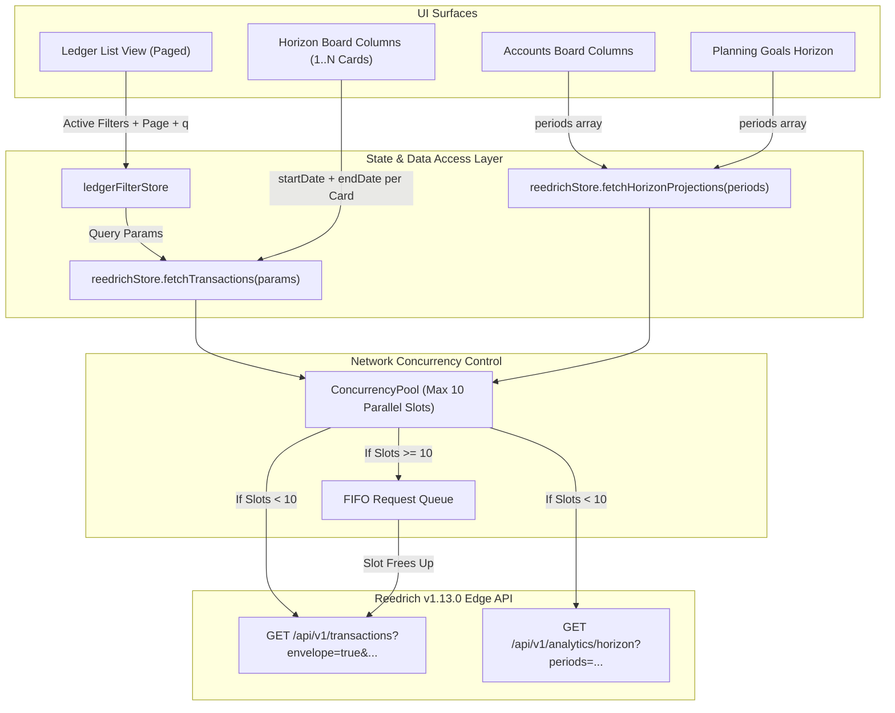

# Design: Server-Driven Filtering, Horizon Projections Engine, and Request Concurrency Pool

## Context

The Reedrich REST API v1.13.0 on Cloudflare Workers and D1 introduces advanced server-side query capabilities:
1. `GET /api/v1/transactions?envelope=true`: Returns structured envelopes with `{ items, pagination: { total, limit, offset, hasNext, totalPages } }`.
2. Universal pagination headers (`X-Total-Count`, `X-Limit`, `X-Offset`, `X-Has-Next-Page`).
3. Case-insensitive substring search via `?q=` and `?search=`.
4. Multi-value filtering via comma-separated query parameters (e.g. `?walletId=w1,w2&categoryId=c1,c2`).
5. Status filter aliases (`status=realized|planned|all`).
6. `GET /api/v1/analytics/horizon`: Generates single-pass edge projections for multi-month cashflow, roll-forward wallet balance accumulation, spendable vs locked trajectories, and goal milestones across 1 to 24 future calendar months.

## Goals / Non-Goals

**Goals:**
- Replace the monolithic `fetchAllTransactions()` loop with parameterized querying: `fetchTransactions(params)`.
- Use server-side filtering, searching (`?q=`), and pagination (`?envelope=true`) in `/ledger`.
- Refactor Horizon Board period columns (`HorizonPeriodColumn.svelte`) to execute localized queries (`startDate` to `endDate`) and compute metrics locally.
- Integrate `GET /api/v1/analytics/horizon` into `reedrichStore.fetchHorizonProjections(periods)` to power macro balance projections in `/accounts` and `/planning`.
- Implement an application-level Concurrency Pool (max 10 parallel connections) with FIFO queueing and `AbortSignal` support.
- Provide granular skeleton and retry states for each independent period card.

**Non-Goals:**
- Re-architecting backend D1 schemas or adding new backend database indexes.
- Implementing offline IndexedDB persistence in this change (in-memory caching only).

## Architecture & Data Flow



## Decisions

### 1. Data Contracts (DTOs)
Add the following interfaces to `src/lib/types/account-detail.ts`:

```ts
export interface PaginationMetadata {
  total: number;
  limit: number;
  offset: number;
  hasNext: boolean;
  totalPages: number;
}

export interface TransactionEnvelope {
  items: TransactionRecord[];
  pagination: PaginationMetadata;
}

export interface HorizonPeriodSummary {
  periodKey: string;
  startDate: string;
  endDate: string;
  cashflow: {
    income: number;
    expense: number;
    net: number;
  };
  netWorth: {
    total: number;
    spendable: number;
    locked: number;
  };
  walletBalances: Array<{
    walletId: string;
    walletName: string;
    balance: number;
    currency: string;
    isLocked: number;
  }>;
  goals: Array<{
    goalId: string;
    name: string;
    currentAmount: number;
    targetAmount: number;
    progressPercentage: number;
    isReached: boolean;
  }>;
}

export interface HorizonBoardDTO {
  baseCurrency: string;
  generatedAt: string;
  startingNetWorth: {
    total: number;
    spendable: number;
    locked: number;
  };
  periods: HorizonPeriodSummary[];
}
```

### 2. Concurrency Pool Implementation (Semaphore Pattern)
- **Decision**: Create `apps/web/src/lib/utils/concurrency-pool.ts` exporting a `ConcurrencyPool` class with a default capacity of 10.
- **Contract**:
  ```ts
  export class ConcurrencyPool {
    constructor(readonly maxConcurrency: number = 10);
    run<T>(task: (signal?: AbortSignal) => Promise<T>, signal?: AbortSignal): Promise<T>;
    clear(): void;
  }
  ```
- **Rationale**: 10 concurrent requests balance responsiveness without saturating Cloudflare Worker execution limits or causing browser connection choking.

### 3. Server-Driven Querying with Envelope Integration
- **Decision**: Implement `reedrichStore.fetchTransactions(params: TransactionQueryParams): Promise<TransactionEnvelope>`.
- Query parameter mapping:
  - `walletId`: string (comma-separated UUIDs if array)
  - `categoryId`: string (comma-separated UUIDs if array)
  - `budgetId`: string (comma-separated UUIDs if array)
  - `type`: 'expense' | 'income' | 'transfer'
  - `status`: 'realized' | 'planned' | 'all'
  - `q`: string (search keyword)
  - `startDate`: string (YYYY-MM-DD)
  - `endDate`: string (YYYY-MM-DD)
  - `limit`: number (default 50, max 200)
  - `offset`: number (default 0)
  - `envelope`: true

### 4. Localized Period Card Architecture
- **Decision**: Refactor `HorizonPeriodColumn.svelte` to maintain its own internal query state:
  ```ts
  let isLoading = $state(true);
  let error = $state<string | null>(null);
  let periodTransactions = $state<TransactionRecord[]>([]);
  ```
- Upon mounting or when `startDate` / `endDate` changes:
  1. Sets `isLoading = true`.
  2. Dispatches `fetchTransactions({ startDate, endDate, limit: 50, envelope: true })` via the concurrency pool.
  3. Computes local cashflow sums (Inflow, Outflow, Net) directly from `periodTransactions`.
  4. Renders its own card skeleton while `isLoading` is true.

## Risks / Trade-offs

- **Multiple HTTP requests vs Single Bundle**: Querying 12 cards creates 12 HTTP requests instead of 1 bundle.
  - *Mitigation*: The concurrency pool queues requests and prevents saturation; Cloudflare Workers edge caching and lightweight JSON payloads (< 5KB per month) make parallel fetches significantly faster than a monolithic download.
- **Client Cache Invalidation**: Mutations (create/edit/delete) must invalidate both the active page and any mounted Horizon Board period cards.
  - *Mitigation*: Maintain a reactive query version token in `reedrichStore` (`queryVersion = $state(0)`) that triggers re-fetch in listening cards when mutations occur.
