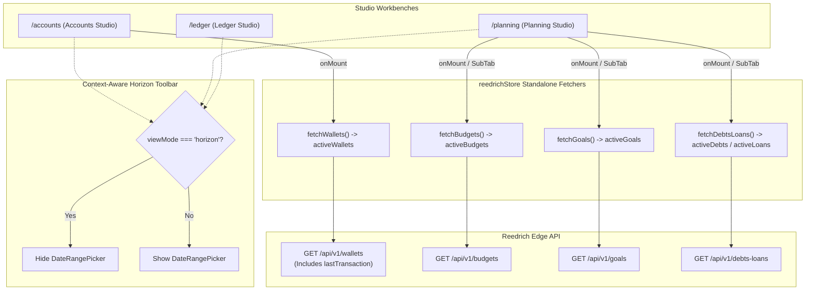

# Design: Decouple Entity Data Fetching and Contextual Horizon UX

## Context

Maniyy V2 uses Svelte 5 runes (`$state`, `$derived`, `$effect`) for reactive state management. While recent changes decoupled transactions, categories, and recurring templates into server-driven pipelines, the Bank & Accounts studio (`/accounts`) and Planning studio (`/planning`) still passively depend on the monolithic `GET /api/v1/account-detail` snapshot.

Specifically:
- `reedrichStore` lacks standalone `fetchWallets()` and `fetchDebtsLoans()` methods.
- `/accounts` renders wallets with stale or null `lastTransaction` objects because `account-detail` does not guarantee deep transaction joins.
- The global `DateRangePicker` appears in the top toolbar during Horizon Board mode across `/ledger`, `/accounts`, and `/planning` (Goals), despite columns having fixed, self-contained monthly horizons.

## Goals / Non-Goals

**Goals:**
- Provide standalone `fetchWallets()` (`GET /api/v1/wallets`) and `fetchDebtsLoans()` (`GET /api/v1/debts-loans`) methods in `reedrichStore`.
- Update `/accounts` to fetch wallets directly on mount and after wallet mutations, surfacing real `lastTransaction` metadata.
- Update `/planning` to trigger standalone fetchers (`fetchBudgets`, `fetchGoals`, `fetchDebtsLoans`) on mount and sub-tab activation.
- Hide `DateRangePicker` across all pages when Horizon Board mode is active.
- Ensure `AccountsHorizonBoard` calculates column subtotals from filtered wallets when search/status filters are applied.

**Non-Goals:**
- Altering the backend Reedrich API schemas (endpoints already exist and return complete metadata).
- Removing the `account-detail` snapshot from Cockpit (`/`), where an executive overview is intentionally desired.

## Architecture & Data Flow



## Decisions

### 1. Dedicated `fetchWallets()` & `fetchDebtsLoans()` in `reedrichStore`
- Implement `fetchWallets(): Promise<WalletItem[]>` querying `GET /api/v1/wallets` through `globalConcurrencyPool`.
- Map backend fields:
  ```ts
  {
    walletId: json.walletId,
    walletName: json.walletName,
    institution: json.walletInstitution ?? json.institution ?? 'General',
    type: json.walletType ?? json.type ?? 'bank',
    balance: json.walletBalance ?? json.balance ?? 0,
    currency: json.walletCurrency ?? json.currency ?? 'IDR',
    isLocked: json.walletIsLocked ?? json.isLocked ?? 0,
    lastTransaction: json.lastTransaction ?? null
  }
  ```
- Store results in `activeWallets = $state<WalletItem[]>([])`.
- Update `allWallets = $derived(this.activeWallets.length > 0 ? this.activeWallets : [...this.spendableWallets, ...this.lockedWallets])`.

### 2. Context-Aware DateRangePicker Visibility
- **`/ledger`**:
  - `{#if settingsStore.settings.ledgerViewMode !== 'calendar_board'}` -> render `DateRangePicker`.
- **`/accounts`**:
  - `{#if viewMode !== 'horizon'}` -> render `DateRangePicker`.
- **`/planning`**:
  - `{#if !(activeSubTab === 'goals' && goalsViewMode === 'horizon')}` -> render `DateRangePicker`.
- **Rationale**: Prevents user confusion by removing non-functional controls in multi-period views while preserving them in List views.

### 3. Reactive Subtotals in `AccountsHorizonBoard`
- When `accountsFilterStore.hasActiveFilters` is true (search query or status filter applied):
  - Compute `col.netWorth`, `col.spendable`, and `col.locked` from `col.wallets` (the filtered subset) in each column.
  - When no filters are active, use `srvPeriod.netWorth` from `GET /api/v1/analytics/horizon`.

## Risks / Trade-offs

- **Initial Load Latency**: Calling `fetchWallets()` in parallel with `fetchSnapshot()` adds 1 lightweight HTTP request (~1KB).
  - *Mitigation*: Both requests run through `globalConcurrencyPool` simultaneously in < 300ms.
- **Offline / Mock Fallback**: When offline, `fetchWallets()` falls back gracefully to `snapshot?.wallets` without throwing unhandled exceptions.
