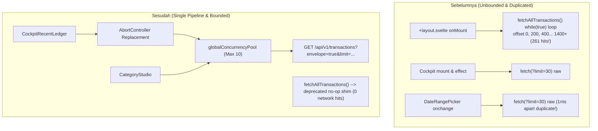

# Design: Eliminate Transaction Fetch Duplication and Unbounded Loops

## Context

Two Jam session recordings (`a7ae0eb0` and `a005a08b`) on `maniyy.membran.app` isolate two distinct network request issues:
1. `CockpitRecentLedger.svelte` runs a private `loadRecent()` using raw `fetch()` directly against `/api/v1/transactions?limit=30`, bypassing store concurrency controls. Its reactive `$effect` and `DateRangePicker` onchange handler fire in parallel, sending duplicate requests 1–2ms apart.
2. `reedrichStore.fetchAllTransactions()` contains an unconstrained `while (true)` loop with `offset += 200` that downloads thousands of historical records sequentially upon user login (`+layout.svelte`), view mounts, and every single transaction mutation (`invalidateAndRefresh()`).

## Goals / Non-Goals

**Goals:**
- Route all transaction reads through `reedrichStore.fetchTransactions()` (envelope + concurrency pool + abort).
- Eliminate the Cockpit duplicate fetch via component-scoped `AbortController` replacement.
- Replace `fetchAllTransactions()` loop with a deprecated no-op shim and delete all callsites.
- Refactor `CategoryStudio.svelte` to query date-scoped transactions instead of full history.
- Ensure post-mutation cache invalidation does not trigger full-history downloads.

**Non-Goals:**
- Changing Cockpit or Category visual layouts.
- Altering the backend API schema (backend v1.13.0 already supports all required parameters).

## Architecture & Data Flow

## Decisions

### 1. Cockpit Feed Migrates to Store Pipeline with Abort-and-Replace
- Replace raw `fetch()` in `CockpitRecentLedger.loadRecent()` with `reedrichStore.fetchTransactions({ startDate, endDate, limit: 30, envelope: true }, signal)`.
- Use a component-scoped `AbortController` in-flight guard: each invocation aborts the previous controller before creating a new one, and effect cleanup aborts on unmount.
- Rationale: eliminates the 1–2ms duplicate request completely; ensures cockpit traffic adheres to the 10-connection concurrency pool.

### 2. Terminate Unbounded `fetchAllTransactions()` While-Loop
- Replace the `while (true)` pagination loop in `reedrichStore.fetchAllTransactions()` with a deprecated no-op returning `Promise<void>`.
- Remove `fetchAllTransactions()` calls from:
  - `apps/web/src/routes/+layout.svelte:31`
  - `apps/web/src/routes/accounts/+page.svelte:74`
  - `apps/web/src/routes/planning/+page.svelte:117`
  - `apps/web/src/lib/components/category/CategoryStudio.svelte:29`
  - `apps/web/src/lib/stores/reedrich.svelte.ts:693` (`invalidateAndRefresh()`)

### 3. Date-Scoped Category Metrics Querying
- Refactor `CategoryStudio.svelte` to query only the active timeframe (`startDate` to `endDate`, `limit: 200`) using `reedrichStore.fetchTransactions()`, passing the resulting items into `calculateCategoryMetrics()`.

### 4. Envelope Normalization in `fetchTransactionsForDrawer`
- Standardize `fetchTransactionsForDrawer` to always request `envelope=true` and parse the unified `TransactionEnvelope` structure.

## Risks / Trade-offs

- **Offline / Mock Mode Behavior**: When in mock mode, `fetchTransactions()` returns mock envelope data without throwing.
- **Category Studio Date Range**: Category metrics reflect the active date filter instead of all-time data, which matches user expectations and the active date picker in Planning.
