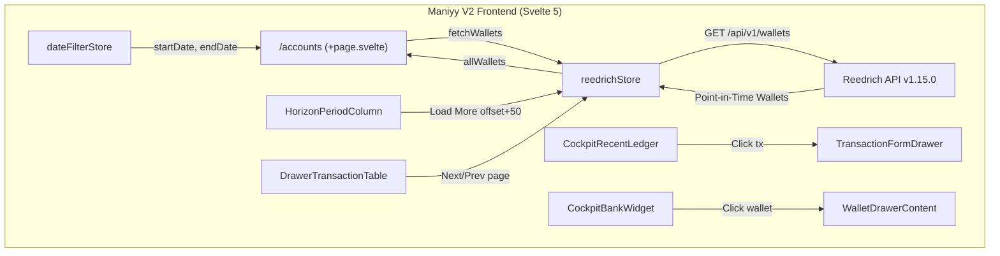

# Design

## Context

See `proposal.md` for background and motivation.

The Reedrich API (v1.15.0) provides:
1. `GET /api/v1/wallets?startDate=...&endDate=...&filter=...`: returns point-in-time wallet balances calculated by the edge worker.
2. `GET /api/v1/transactions?status=realized&orderBy=date&direction=desc&limit=...&offset=...&envelope=true`: structured paginated query response with total count and paging metadata.

In the web app:
- `apps/web/src/routes/accounts/+page.svelte` hosts the Account & Banking dashboard.
- `apps/web/src/lib/components/cockpit/CockpitRecentLedger.svelte` displays recent transactions in the Cockpit.
- `apps/web/src/lib/components/cockpit/CockpitBankWidget.svelte` lists institutions and sub-wallets.
- `apps/web/src/lib/components/ledger/HorizonPeriodColumn.svelte` displays transactions grouped by calendar month.
- `apps/web/src/lib/components/drawer/DrawerTransactionTable.svelte` renders transactions inside entity drilldown drawers.

## Goals / Non-Goals

**Goals:**
- Enable server-driven point-in-time wallet balance queries in `/accounts` when `dateFilterStore` changes.
- Refine Cockpit UX: allow clicking transactions to open the edit drawer, open wallet drawers directly from the bank widget, and order recent transactions by date descending.
- Eliminate silent truncation in `HorizonPeriodColumn` and `DrawerTransactionTable` through responsive pagination.
- Maintain compatibility with minimalist-ui design tokens and high-contrast styling standards.

**Non-Goals:**
- Modifying backend endpoints or Cloudflare Worker routes (API v1.15.0 is already deployed).
- Implementing virtualized lists or complex infinite scroll libraries (native Svelte 5 runes with "Load More" button or table paging is sufficient).

## Architecture & Data Flow

## Decisions

### 1. Server-Driven Point-in-Time Wallets over Client Computation
- **Decision**: Update `reedrichStore.fetchWallets({ startDate, endDate, filter })` to pass query parameters directly to `GET /api/v1/wallets`. In `/accounts/+page.svelte`, replace the broken `pointInTimeBalances` derived from empty `allTransactions` with the server-returned wallet balances.
- **Rationale**: The backend edge worker has full access to the database mutations and computes exact point-in-time historical and projected balances. This avoids duplicating financial roll-forward math on the client.

### 2. Cockpit Interaction: Drawer Inspection vs Page Jump
- **Decision**: 
  - Clicking any transaction in `CockpitRecentLedger` calls `transactionFormStore.openView(tx)`.
  - Clicking a sub-wallet row in `CockpitBankWidget` calls `reedrichStore.openDrawer({ type: 'wallet', ... })` and loads its drawer transactions.
  - The card headers / "Lihat Semua" buttons retain their normal routing links (`/ledger` and `/accounts`).
- **Rationale**: Preserves user focus in the Cockpit workbench for quick inspection and corrections while keeping cross-page navigation accessible via explicit action buttons.

### 3. Pagination Strategy for Horizon Columns and Drawers
- **Decision**:
  - `HorizonPeriodColumn`: When `envelope.pagination.hasNext` is true, render a minimalist "Muat Lebih Banyak" button at the bottom of the transaction feed. Clicking it fetches the next 50 transactions with `offset = currentList.length` and appends them.
  - `DrawerTransactionTable`: Include a compact pagination footer (`< Prev | Page X of Y | Next >`) bound to `offset` and `limit`, maintaining cached views per page.
- **Rationale**: Simple, highly predictable, accessible, and compliant with minimalist-ui styling without third-party dependencies.

## Test Strategy

1. **Unit Tests (Vitest)**:
   - Test `fetchWallets` with `startDate`, `endDate`, and `filter` options ensuring correct query string serialization.
   - Test `fetchTransactions` query builder with `orderBy` and `direction`.
   - Test `TransactionQueryParams` in shared package.
2. **E2E Tests (Playwright)**:
   - Verify changing date filters in `/accounts` triggers wallet requests and updates UI cards.
   - Verify clicking a recent transaction in Cockpit opens the transaction drawer.
   - Verify clicking a wallet in Cockpit Bank Widget opens the wallet drawer.
   - Verify pagination controls in `DrawerTransactionTable` and `HorizonPeriodColumn`.
