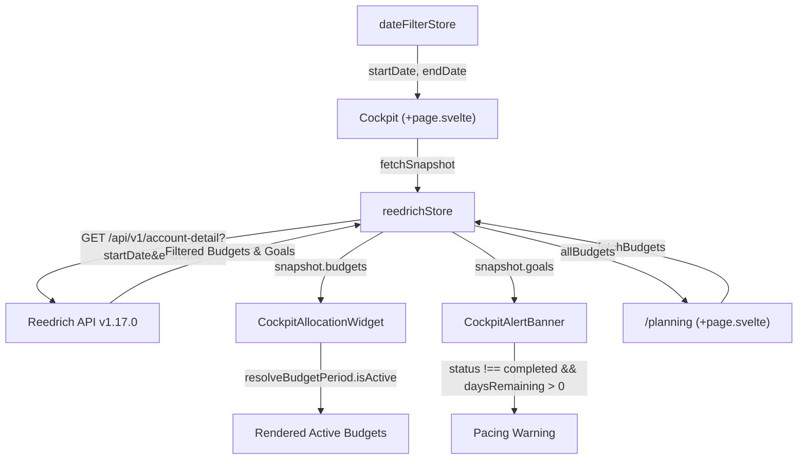

# Design

## Context

See `proposal.md` for background and motivation.

In Reedrich v1.17.0, `GET /api/v1/account-detail` performs backend temporal filtering on `budgets`:
- Calling `GET /api/v1/account-detail` without query bounds or with the current month returns only budgets valid for the current timeframe (omitting past completed budgets).
- Calling `GET /api/v1/account-detail?startDate=2026-09-01&endDate=2026-09-30` returns budgets whose periods overlap with September 2026.

However, in the web application:
1. `apps/web/src/routes/+page.svelte` (Cockpit) currently renders `CockpitAllocationWidget` and `CockpitAlertBanner` without re-fetching `account-detail` when `dateFilterStore` changes.
2. In `apps/web/src/lib/stores/reedrich.svelte.ts`, `fetchBudgets()` overwrites `this.snapshot.budgets = items`. When the user visits `/planning`, the entire historical list of budgets replaces the snapshot's filtered array.
3. `CockpitAllocationWidget.svelte` maps `reedrichStore.activeBudgets` directly without filtering for `resolveBudgetPeriod(b).isActive`.
4. `CockpitAlertBanner.svelte` evaluates `goals.find(...)` without verifying whether the goal's target date is still ahead or if the goal has been marked `isReached` / `completed`.

## Goals / Non-Goals

**Goals:**
- Connect Cockpit to `dateFilterStore` so that adjusting the global date range triggers a server-driven `fetchSnapshot({ startDate, endDate })`.
- Separate standalone budget management (`fetchBudgets()` storing into `allBudgets`) from the temporal snapshot (`snapshot.budgets`).
- Filter Cockpit budgets using `resolveBudgetPeriod(b).isActive` so past completed budgets never show under "Active Budgets".
- Guard Cockpit alert banner so only unreached, non-overdue goals with positive `daysRemaining` trigger deficit warnings.

**Non-Goals:**
- Redesigning the Planning page (`/planning` already possesses its own lifecycle filter tabs for Active, Past, and All).
- Changing backend worker logic (Reedrich v1.17.0 is already active and tested).

## Architecture & Data Flow

## Decisions

### 1. Isolate Standalone Budgets from Snapshot
- **Decision**: In `reedrichStore.fetchBudgets()`, store the array into `this.allBudgets = items` instead of modifying `this.snapshot.budgets`. Keep `activeBudgets` as a derived property of `this.snapshot?.budgets ?? []`.
- **Rationale**: `this.snapshot.budgets` is the source of truth for the active temporal snapshot. Overwriting it with full historical records from `/api/v1/budgets` violates the single-responsibility principle of the snapshot.

### 2. Dual-Layer Protection in CockpitAllocationWidget
- **Decision**: Even though backend v1.17.0 filters expired budgets, `CockpitAllocationWidget` will derive `activeBudgets = $derived(budgets.filter((b) => resolveBudgetPeriod(b).isActive))`.
- **Rationale**: Provides defensive client-side resilience against edge cases (e.g. mock data mode, cached snapshots, or clock discrepancies between client and server).

### 3. Pacing Alert Banner Validation
- **Decision**: Update `CockpitAlertBanner.svelte` to check `const lifecycle = resolveGoalLifecycle(sewaGoal)` and only render when `!lifecycle.isCompleted && !lifecycle.isOverdue && deficit > 0`.
- **Rationale**: Prevents alarming the user with deficit warnings for goals whose target deadlines have passed or whose milestones have already been reached.

## Test Strategy

1. **Unit Tests (Vitest)**:
   - Verify `fetchBudgets()` populates `allBudgets` without modifying `snapshot.budgets`.
   - Test `resolveBudgetPeriod` and `resolveGoalLifecycle` against boundary dates.
2. **E2E Tests (Playwright)**:
   - In Cockpit, verify that completed past budgets (such as September 2026 budgets) are not rendered when viewing October 2026.
   - Verify that switching date presets to a past month re-fetches snapshot with date bounds.
