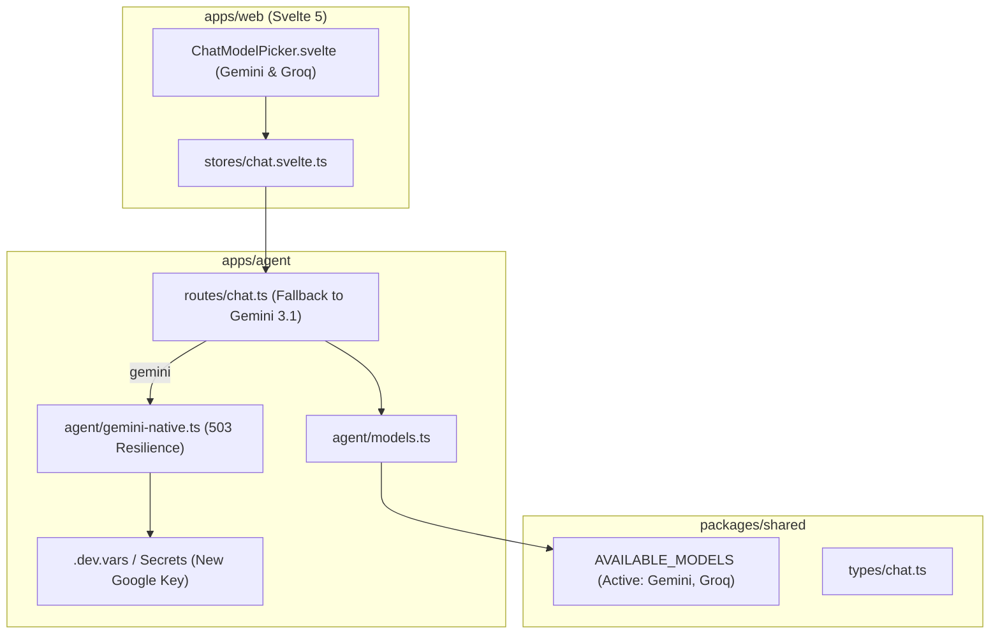

# Design: Provider Error Fixes for Google Gemini & Disabling OpenCode

## Context

Lihat `proposal.md` untuk motivasi dan latar belakang masalah. Saat ini, sistem chat agent terbagi menjadi tiga paket utama:
- Backend Cloudflare Worker (`apps/agent`): Mengelola streaming chat, multi-step tool execution via `@google/genai` (native Gemini) dan AI SDK (`@ai-sdk/groq` untuk Groq).
- Shared Types (`packages/shared`): Mendefinisikan tipe model, konfigurasi thinking, dan payload chat.
- Frontend Svelte 5 (`apps/web`): Mengelola UI chat, store `chatStore`, dan pemilih model `ChatModelPicker.svelte`.

Kegagalan penyedia AI saat ini disebabkan oleh key Google yang kedaluwarsa, error 503 high-demand pada flash model terbaru Google, serta model OpenCode upstream yang telah dihapus (`deepseek-v4-flash-free`), error 500 pada `/chat/completions` (`muse-spark-1.3-contributor-free`), penolakan origin token `"public"` (`403 FreeTierError`), dan keterbatasan timeout tool-calling pada model mainan seperti `space-bunny-free`.

## Goals / Non-Goals

**Goals:**
- Memperbarui kunci API Google Generative AI ke kunci baru yang valid (`AQ.Ab8RN6IdIhUs6lMi_QQ9HyNjc8-esITMmdlSHH66n-of-HWj_w`) pada file runtime lokal (`apps/agent/.dev.vars`) dan benchmark/eval scripts.
- Menetapkan `gemini-3.1-flash-lite` sebagai default Gemini model yang stabil dan cepat (terbukti 200 OK tanpa throttling kuota).
- Menambahkan penanganan error yang ramah pada `gemini-native.ts` ketika Google mengembalikan HTTP 503 (high demand spikes).
- Menonaktifkan/menghapus model `opencode` dari `AVAILABLE_MODELS` di `@maniyy/shared` dan `apps/agent/src/agent/models.ts`.
- Menyederhanakan `ChatModelPicker.svelte` agar hanya menampilkan model aktif (Gemini dan Groq) tanpa bagian OpenCode yang rusak.
- Menjaga seluruh test suite Vitest unit tests pada `apps/agent` dan `apps/web` tetap lulus (pass).

**Non-Goals:**
- Membuat akun berbayar OpenCode atau memaksa integrasi model tidak stabil yang sering mengalami timeout.
- Memodifikasi skema database D1 (`conversations` dan `messages` tetap memakai skema eksisting).

## Decisions

### 1. Konfigurasi Kunci Google Gemini & Default Model
- **Keputusan**: Kunci baru disimpan di `apps/agent/.dev.vars` sebagai `GEMINI_API_KEY=AQ.Ab8RN6IdIhUs6lMi_QQ9HyNjc8-esITMmdlSHH66n-of-HWj_w` untuk development lokal, dan diperbarui di script eval `eval/run-gemini.ts` dan `eval/run.ts`.
- **Default Model**: Di `apps/agent/src/routes/chat.ts`, default model yang di-fallback dipertahankan pada `gemini-3.1-flash-lite`, yang terbukti memiliki latensi rendah dan lulus pengujian 200 OK.
- **Handling Error 503**: Pada `apps/agent/src/agent/gemini-native.ts`, tangkap error 503 dan yield pesan teks bersahabat: *"Model sedang mengalami lonjakan beban tinggi sementara di Google. Silakan coba lagi sebentar lagi atau gunakan model Gemini 3.1 Flash Lite."*

### 2. Menonaktifkan Provider OpenCode (Opsi A)
- **Keputusan**: Upstream gateway OpenCode telah menonaktifkan model `deepseek-v4-flash-free`, melempar HTTP 500 untuk `muse-spark-1.3-contributor-free`, memblokir token `"public"` dari luar CLI, dan model alternatif `space-bunny-free` timeout pada tool calling. Solusi paling stabil dan bersih untuk pengguna adalah menonaktifkan provider OpenCode dari daftar model aktif.
- **Model Registry Update**:
  - Hapus entri model `opencode` dari `packages/shared/src/chat.ts` dan `apps/agent/src/agent/models.ts`.
  - Jika ada request lama dengan `provider: 'opencode'`, `apps/agent/src/routes/chat.ts` otomatis memetakan fallback ke default `gemini-3.1-flash-lite`.

### 3. Pembersihan UI & Sinkronisasi Test Suite
- Perbarui `apps/web/src/lib/components/chat/ChatModelPicker.svelte` untuk menghapus bagian OpenCode Zen, sehingga UI bersih dan hanya menampilkan Gemini dan Groq.
- Perbarui test suite di `apps/agent/src/__tests__/unit/` dan `apps/web/tests/chat-reasoning.spec.ts` agar menyelaraskan assertions dengan model aktif saat ini.

## Risks / Trade-offs

- **Percakapan Lama dengan Provider OpenCode**: Database D1 mungkin menyimpan conversation lama dengan `provider = 'opencode'`.
  - *Mitigasi*: Fallback otomatis di `apps/agent/src/routes/chat.ts` mengarahkan ke model default (`gemini-3.1-flash-lite`) saat model config yang diminta tidak ditemukan di `AVAILABLE_MODELS`.
