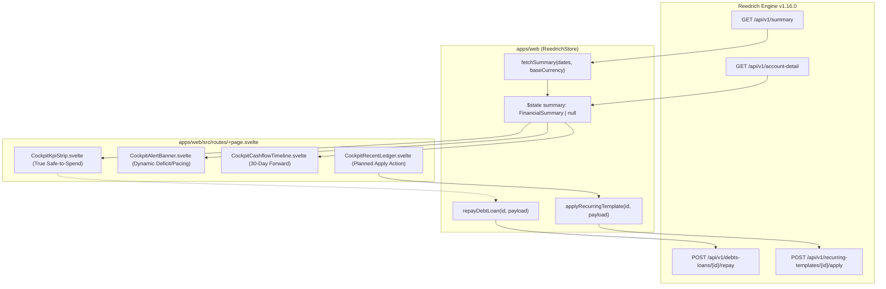

# Design: Reedrich v1.16.0 Summary & Safe-to-Spend Runway Cockpit Integration

## Context

Lihat `proposal.md` untuk motivasi dan latar belakang masalah. Saat ini, sistem dasbor Maniyy V2 mengandalkan snapshot atomik `GET /api/v1/account-detail`. Pada versi Reedrich v1.16.0, backend menghadirkan engine baru `GET /api/v1/summary` yang mengkalkulasikan:
- *Safe-to-Spend Runway* matematis yang memotong pengeluaran terencana, komitmen rutin 30 hari, dan cicilan aktif dari kas operasional.
- *Daily Safe-to-Spend Allowance* berdasarkan sisa hari dalam periode aktif.
- *30-Day Forward Cashflow Projections* yang memetakan tagihan terjadwal bulanan secara berurutan.
- Endpoint mutasi atomik untuk pelunasan hutang (`/api/v1/debts-loans/{id}/repay`) dan realisasi transaksi rutin (`/api/v1/recurring-templates/{id}/apply`).



## Goals / Non-Goals

**Goals:**
- Mengintegrasikan kontrak `FinancialSummary` ke `$lib/types/account-detail.ts` dan merefleksikannya dalam reactive state `$state<FinancialSummary | null>(null)` di `ReedrichStore`.
- Menyelaraskan tile kedua pada `CockpitKpiStrip.svelte` agar menampilkan `summary.safeToSpend` dan alokasi harian `summary.dailySafeToSpend` (misal: *Rp 375.000 / hari · 12 hari tersisa*).
- Menambahkan penanganan visual khusus saat kondisi defisit (`safeToSpendDetails.isDeficit === true`): menampilkan angka negatif dengan badge peringatan merah monokrom tanpa merusak estetika *minimalist-ui*.
- Memperbarui `CockpitAlertBanner.svelte` secara dinamis bereaksi pada status defisit kas aman (`isDeficit`) dan peringatan pacing target terdekat tanpa hardcoded string `"sewa rumah"`.
- Membangun komponen baru `CockpitCashflowTimeline.svelte` untuk menyajikan proyeksi tagihan dan arus kas 30 hari ke depan pada kolom kanan Cockpit.
- Menambahkan tombol aksi interaktif *"Terapkan"* pada daftar mutasi terencana di `CockpitRecentLedger.svelte` untuk merealisasikan transaksi melalui `applyRecurringTemplate`.
- Menyediakan metode `repayDebtLoan()` di `ReedrichStore` untuk mendukung pelunasan hutang dengan pemotongan saldo dompet secara atomik.

**Non-Goals:**
- Mengubah skema database backend Cloudflare D1 (seluruh perhitungan dikelola oleh engine Reedrich API).
- Mengubah desain halaman lain (`/accounts`, `/planning`, `/ledger`) di luar integrasi data summary dan aksi mutasi.

## Decisions

### 1. Struktur Data `FinancialSummary` di TypeScript
- **Keputusan**: Tambahkan antarmuka `FinancialSummary`, `SafeToSpendDetails`, dan `CashflowProjectionGroup` di `apps/web/src/lib/types/account-detail.ts`:
  ```ts
  export interface SafeToSpendDetails {
    remainingDays: number;
    plannedExpensesDeducted: number;
    recurringExpensesDeducted: number;
    activeDebtDeducted: number;
    isDeficit: boolean;
    recurringProjectionInformationalOnly?: boolean;
  }

  export interface CashflowEventItem {
    templateId: string;
    templateName: string;
    date: string;
    amount: number;
    adminFee: number;
    type: 'income' | 'expense' | 'transfer';
    walletId: string | null;
    targetWalletId: string | null;
    categoryId: string | null;
  }

  export interface CashflowProjections {
    lookaheadDays: number;
    startDate: string;
    endDate: string;
    projectedIncome: number;
    projectedExpense: number;
    projectedAdminFees: number;
    projectedNetChange: number;
    events: CashflowEventItem[];
  }

  export interface FinancialSummary {
    netWorthByCurrency: Record<string, number>;
    netWorthByInstitution: Record<string, number>;
    consolidatedNetWorth: {
      baseCurrency: string;
      estimatedTotal: number;
      isEstimated: boolean;
      exchangeRatesSource?: string;
    };
    spendableCash: {
      byCurrency: Record<string, number>;
      estimatedTotal: number;
      currency: string;
    };
    lockedCash: {
      byCurrency: Record<string, number>;
      estimatedTotal: number;
      currency: string;
    };
    safeToSpend: number;
    dailySafeToSpend: number;
    safeToSpendDetails: SafeToSpendDetails;
    totalIncome: number;
    totalExpense: number;
    totalAdminFees?: number;
    netSavings: number;
    totalDebt: number;
    totalReceivable: number;
    cashflowProjections?: CashflowProjections;
    categoryBreakdown?: Record<string, number>;
  }
  ```

### 2. Sinkronisasi Bersamaan (Parallel Fetch) di `ReedrichStore`
- **Keputusan**: Di dalam `fetchSnapshot()`, jalankan pemanggilan `fetchSummary()` secara paralel menggunakan `Promise.allSettled` agar tidak menambah latensi halaman Cockpit.
- **Offline / Mock Fallback**: Saat offline atau menggunakan mock, buat fungsi helper `createMockSummary(snapshot)` yang mengestimasi safe-to-spend dari data snapshot lokal sehingga komponen tidak mengalami *null reference exception*.

### 3. Visualisasi KPI Safe-to-Spend & Defisit di Cockpit
- **Tile Safe-to-Spend**:
  - Jika `safeToSpend >= 0`: Angka berwarna hijau gelap (`#346538`), subtitle menampilkan `Rp X / hari · Y hari tersisa`.
  - Jika `safeToSpend < 0` (Defisit): Angka berwarna merah bata (`#9F2F2D`), subtitle menampilkan badge `Defisit Komitmen (Kurang Rp X)`, menuntun pengguna untuk menyesuaikan alokasi.
- **Alert Banner**:
  - Menampilkan banner peringatan prioritas:
    1. **Priority 1**: Defisit Kas Aman (`isDeficit === true`). Menampilkan total komitmen yang belum tertutup dana cair.
    2. **Priority 2**: Target Finansial Paling Kritis (rasio sisa hari $\le 30$ hari dengan dana terkumpul $< 80\%$).

### 4. Widget Proyeksi Arus Kas 30 Hari (`CockpitCashflowTimeline.svelte`)
- **Lokasi**: Ditempatkan di kolom kanan (`xl:grid-cols-[1fr_1.8fr_1fr]`) di bawah widget alokasi bulanan (`CockpitAllocationWidget.svelte`).
- **Desain**: Mengikuti prinsip *minimalist-ui*: Kartu berlatar putih dengan border 1px solid `#EAEAEA`, header dengan badge projected net change (`+` hijau atau `-` merah), dan daftar baris tagihan terurut tanggal dilengkapi ikon tipe (pemasukan/pengeluaran/transfer) serta tanggal jatuh tempo.

### 5. Tombol Realisasi Transaksi Terencana di Recent Ledger
- **Interaksi**: Pada tab *Planned* di `CockpitRecentLedger.svelte`, jika transaksi memiliki `recurringTemplateId` atau berstatus planned, tampilkan tombol kecil `Terapkan` di samping baris.
- **Feedback**: Menggunakan loading spinner mikro dan auto-refresh snapshot serta summary setelah selesai.

## Responsive Behavior

- **Desktop ($\ge$ 1024px)**: Layout 3 kolom mempertahankan keseimbangan beban visual:
  - Kolom kiri: Bank Accounts & Subtotals.
  - Kolom tengah: Live Recent Transactions & Planned tab dengan tombol Terapkan.
  - Kolom kanan: Alokasi Anggaran Bulanan & Widget Proyeksi Arus Kas 30 Hari.
- **Mobile (< 1024px)**:
  - KPI Strip dirender dalam format 2x2 grid responsif.
  - Banner peringatan defisit tampil ringkas di bagian atas.
  - Kolom disusun vertikal berurutan dengan scroll container yang ramah sentuhan.

## Test Strategy

- **Unit Tests (Vitest)**:
  - `apps/web/src/lib/stores/reedrich.test.ts`: Uji pemanggilan `fetchSummary()`, penanganan mock fallback summary, dan kalkulasi aman saat `isDeficit` bernilai boolean.
  - `apps/web/src/lib/stores/reedrich-crud.test.ts`: Uji pemanggilan `repayDebtLoan()` dan `applyRecurringTemplate()`.
  - `apps/web/src/lib/components/cockpit/CockpitKpiStrip.test.ts`: Uji render nominal safe-to-spend dan badge defisit.
- **E2E Tests (Playwright)**:
  - `apps/web/tests/cockpit.spec.ts`: Verifikasi interaksi KPI strip, alert banner, dan tab Planned dengan tombol Terapkan.
